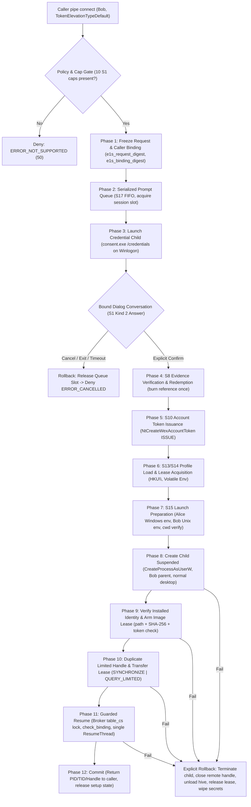

<!-- SPDX-License-Identifier: GPL-2.0-or-later -->
<!-- Copyright 2026 WineExplorer contributors -->
# E1-S18: Broker Wine-Only Integration

Survey, architecture, trust decisions, failure handling, and implementation design for Work Package E1-S18 of [E1-S](E1_S_STANDARD_USERS.md) (section 7 row 18, "broker Wine-only integration").
Following [E1 decisions](E1_DECISIONS.md), [S1 contracts](E1_S1_CONTRACTS.md), [S4 accounts map](E1_S4_ACCOUNTS_MAP.md), [S5 broker records](E1_S5_BROKER_RECORDS.md), [S6 transport](E1_S6_TRANSPORT.md), [S7 PAM worker](E1_S7_PAM_WORKER.md), [S8 evidence](E1_S8_EVIDENCE.md), [S10 token](E1_S10_TOKEN.md), [S12 profile storage](E1_S12_PROFILE_STORAGE.md), [S13 HKU load](E1_S13_HKU_LOAD.md), [S14 leases](E1_S14_LEASES.md), [S15 profile env / launch prep](E1_S15_PROFILE_ENV.md), [S16 coverage](E1_S16_COVERAGE.md), and [S17 credential dialog](E1_S17_CREDENTIAL_DIALOG.md).

---

## 1. Codebase Survey & File:Line Evidence

| Component / Subsystem | File & Lines | Implementation Details & Architectural Evidence |
|---|---|---|
| **Caller Elevation Identification** | `src/programs/wexelevate/main.c:520-527` | `identify_caller()` queries `TokenElevationType`. Currently: `TokenElevationTypeLimited` returns `ERROR_SUCCESS` (filtered admin); `TokenElevationTypeDefault` (standard user) and `TokenElevationTypeFull` (already elevated) return `ERROR_NOT_SUPPORTED` (50). S18 branches `TokenElevationTypeDefault` to the standard-user credential flow when and only when all 10 S1 capabilities are present and lab define `WEXELEVATE_E1S18` + runtime policy `EnableStandardUserElevation` are enabled. Filtered admin remains byte-for-byte unchanged. |
| **Request Parsing & Hygiene** | `src/programs/wexelevate/main.c:548-590` | `parse_request()` checks magic `WEXELEVATE_MAGIC`, version `WEXELEVATE_VERSION`, string lengths, NUL character absence, absolute image path (`[A-Za-z]:[\\/]`). For standard user, inherited environment (`WEXELEVATE_ENV_INHERIT`) is strictly forbidden and rejected. |
| **Request ID & Table Collision** | `src/programs/wexelevate/main.c:190-223` | `table_add()` allocates an unoccupied slot in `table[MAX_REQUESTS]` (32 slots) and generates a cryptographic 64-bit random ID via `random_id()`. Checks against collision with existing live table entries. RNG failure or collision retry exhaustion denies with `ERROR_GEN_FAILURE`. Slot stays reserved until request cleanup (`free_request`). |
| **Image Freeze, Leases & Hashing** | `src/programs/wexelevate/main.c:626-655` | `freeze_image()` opens `req->image_file` with `FILE_SHARE_READ`, acquires host Linux read lease via `pLeaseTake()` (wexhost), creates `req->lease_event`, and hashes the file with SHA-256 via `hash_file()` (`BCryptHashData`). Held open through launch. |
| **H2/S3 Provenance & Caller Binding** | `src/programs/wexelevate/main.c:390-475` | `check_binding()` rechecks opener and consumed-writer process handles, primary token handles, `TokenId`, `ModifiedId`, `AuthenticationId`, session, and SID via `NtQueryWexPipeCallerBindingEx` (protocol 976). Ensures no impersonation, process liveness, and token immutability. |
| **Filtered-Admin Launch Path** | `src/programs/wexelevate/main.c:1023-1210` | `launch()` retrieves `TokenLinkedToken` (which must be Primary, Full, same logon AuthenticationId, same caller SID, same session). Creates suspended, duplicates limited handle (`SYNCHRONIZE \| PROCESS_QUERY_LIMITED_INFORMATION`), arms lease (`pLeaseArm`), starts guard (`start_guard`), verifies caller binding and stop event, and calls `ResumeThread`. Failure terminates suspended child, closes remote handle in caller table (`DUPLICATE_CLOSE_SOURCE`), and rolls back. |
| **Sequential Dispatch** | `src/programs/wexelevate/main.c:1658-1691` | `handle_request()` executes sequential pipeline: `identify_caller -> parse_request -> table_add -> freeze_image -> [probe hook] -> check_binding -> approve -> check_binding -> table_consume -> verify_image -> lease_arm -> launch`. S18 introduces a clean branch for standard callers without altering filtered-admin execution. |
| **S1/S5 Records & State Engine** | `src/programs/wexelevate/e1s.h:32-36, 80-89, 288-299` | Defines logical states: `QUEUED -> PROMPTING -> AUTHENTICATING -> IDENTITY_READY -> CONSUMED -> LAUNCH_PREPARED -> COMMITTED` (with terminal `CANCELLED`). Enforces canonical SHA-256 domain tags: `"E1S1-BIND\0"`, `"E1S1-REQ\0"`, `"E1S1-ENV\0"`. |
| **S17 Credential Dialog & Prompt Queue** | `src/programs/wexelevate/cred_dialog.c:1-550`, `cred_dialog.h:1-199` | Implements H3b serialized prompt queue (`wex_prompt_queue_enqueue`, FIFO, limits: 2/caller, 8/session, 32/global), S4 typed account validation (`wex_valid_account_name`: length 1..63, `[a-zA-Z0-9_.-]`), secure buffer wipe (`wex_secure_wipe`), S1 Kind 2 Answer Record serialization/verification (`wex_build_answer_record`, `wex_verify_answer_record`), and conversation state machine. Child exit without explicit Confirm fails closed. |
| **S15 Environment & Launch Prep** | `src/programs/wexelevate/launch_prep.c:1-450`, `launch_prep.h:1-114` | `wex_prepare_launch()` validates same-server inputs, generates Alice's Windows environment (with prefix-local profile directories), sanitizes Bob's Unix environment (`HOME`, `USER`, `LOGNAME`, `DISPLAY`), strips dangerous variables (`LD_*`, `SSH_*`, `WINE*`, `KRB5*`, `DBUS_*`), checks cwd containment without symlink traversal, and strictly rejects real-UID transitions (`WEX_LAUNCH_PREP_ERR_REAL_UID_UNSUPPORTED`). |
| **S8 Native Evidence & Quotas** | `tools/e1s6/evidence.py:1-331` | Manages single-use connection-owned evidence (S1 Kind 3, 220 bytes), limits (3 attempts per request, 120s total request deadline, 1 active per UID/session), authoritative S4 account key/incarnation binding, and atomic redemption. |
| **S7 PAM Conversation Worker** | `tools/e1s7/pam-worker.c:1-500` | Native root worker running fixed service `wineexplorer-elevate` (lab `wex-e1s-test`), executing `pam_authenticate` (rejecting null tokens) and `pam_acct_mgmt`, resolving canonical `PAM_USER`, and zeroing secret buffers with `explicit_bzero`. |
| **S10 Server Token Issuance** | `wine/server/token.c:2903-2962` | Handles `create_e1s_account_token` (request 324, protocol 979): `WEX_TOKEN_NEGOTIATE` (checks caps `0xc0`), `WEX_TOKEN_ISSUE` (204-byte envelope = S1 Kind 4 record + 16-byte evidence ref -> S1 Kind 5 response + non-inheritable Primary, Full, High token with fresh logon LUID and caller session). Retains standard session linked-token denial (`line 2970`). |
| **S13/S14 Profile Load & Leases** | `wine/server/registry.c:3088-3450`, `wex_profile_storage.c:1-1000` | Handles `load_e1s_profile` (request 325, protocol 979): `WEX_HKU_LOAD` (verifies broker role and context, locks prefix/SID, loads hive under `HKU\<Alice SID>`, publishes Volatile Environment with Alice's 9 variables, issues S14 lease in state 1), `WEX_HKU_TEST_TRANSFER` (commit process tracking, state 2), `WEX_HKU_UNLOAD_S14` (last-user and open-handle safe unload). |
| **S6 Transport & Endorsement** | `src/dlls/wexhost/e1s6.c:1-600` | Enforces server endorsement of broker process object and connection, pins bus owner and host PID, and imports control socket. |

---

## 2. End-to-End Execution Sequence for Standard User Elevation

The complete lifecycle for `e1s18_handle_standard_request()` proceeds through the following strictly ordered phases:

### Detailed Sequence Steps

1. **Gate & Pre-Flight Validation**:
   - Verify caller token elevation: must be `TokenElevationTypeDefault`.
   - Verify runtime policy: `HKLM\Software\WineExplorer\Elevation\EnableStandardUserElevation` must be `1` (default `0` denies with `ERROR_NOT_SUPPORTED`).
   - Verify all 10 S1 capabilities (`0x3ff`): `H2_OPENER`, `MESSAGE_PROVENANCE`, `BINDING_V1`, `DIALOG_V1`, `VERIFIER_V1`, `EVIDENCE_V1`, `ACCOUNT_MAP_V1`, `TOKEN_V1`, `PROFILE_V1`, `COMMIT_GUARD_V1`. Any missing bit denies with `ERROR_NOT_SUPPORTED` (never falls back).
   - Verify request flags: `WEXELEVATE_ENV_INHERIT` is strictly forbidden for standard users; if set, denies with `ERROR_INVALID_PARAMETER`.
   - Verify caller binding: `check_binding()` proves opener process, opener primary token, no impersonation, matching session, and valid logon LUID.

2. **Request & Caller Freeze**:
   - Compute `binding_digest`: SHA-256 over `"E1S1-BIND\0"` + S1 Kind 1 canonical caller binding record.
   - Compute `request_digest`: SHA-256 over `"E1S1-REQ\0"` + request ID, binding digest, held image metadata (volume serial, file index, file size, last-write time, SHA-256), image path, command line, absolute cwd, environment policy (`1` = fresh managed), show state, flags, and 120s deadline.
   - Compute `environment_digest`: SHA-256 over `"E1S1-ENV\0"` + `env_policy` (`1`).
   - Generate cryptographic 32-byte `nonce`.

3. **Prompt Serialization & Credential Dialog (S17)**:
   - Enqueue in session prompt queue (`wex_prompt_queue_enqueue`).
   - Check per-caller limit: at most 2 active/queued requests per caller PID (`WEX_PROMPT_QUEUE_PER_CALLER_LIMIT`). If exceeded, deny with `ERROR_BUSY`.
   - Check per-session limit (8) and global limit (32).
   - Wait for slot activation in FIFO order.
   - Spawn credential child on `WinSta0\Winlogon` (or `WinSta0\Default` if insecure desktop policy configured):
     `consent.exe /broker /credentials /ppid <broker_pid> /request %016llx /token <nonce_hex> /channel <handle> [/secure]`
   - Dialog displays mandatory explanation:
     *"The administrator account's rights apply inside this Wine prefix only, with no host or root access. The requesting user's host account and files are unchanged. Settings for this program are stored in this Wine prefix only."*
   - Child sends typed account name: validated with `wex_valid_account_name` (S4 rule).
   - Only an explicit S1 Kind 2 Answer Record with `answer_kind == 2` (Confirm) matching request ID, attempt, nonce, binding digest, request digest, and channel ID approves.
   - Any child termination, crash, timeout (120s), or cancel (`answer_kind == 3`) fails closed with `ERROR_CANCELLED` (1223).
   - Dequeue and release prompt slot (`wex_prompt_queue_release`).

4. **Single-Use Evidence & Quotas (S8 / S7)**:
   - S8 native evidence service validates PAM conversation result from S7 worker (fixed service `wineexplorer-elevate`, `pam_authenticate` + `pam_acct_mgmt`, final `PAM_USER` mapped to S4 account key).
   - S8 returns S1 Kind 3 Evidence Record (220 bytes) + 16-byte connection-bound reference.
   - Broker verifies:
     - `request_id`, `request_digest`, `binding_digest`, `nonce` match frozen request.
     - `host_uid` matches Bob's host UID (Wine-only identity boundary).
     - Account key is an active administrator in S4 account map.
     - Monotonic expiry is valid (`now < expiry`).
   - Broker redeems evidence reference: reference is burned atomically by verifier. Replay or reuse is impossible.

5. **Account Token Issuance (S10)**:
   - Dispatch `NtCreateWexAccountToken(WEX_TOKEN_ISSUE, ...)` (request 324, protocol 979) with 204-byte envelope (S1 Kind 4 record + 16-byte evidence reference).
   - Server validates context, broker SYSTEM credentials, consumes request, builds account token, and allocates fresh logon LUID.
   - Broker receives Primary token handle and S1 Kind 5 response (136 bytes).
   - Broker independently queries token via `GetTokenInformation`:
     - `TokenType == TokenPrimary`.
     - `TokenElevationType == TokenElevationTypeFull`.
     - `TokenIntegrityLevel >= 0x3000` (High).
     - `TokenSessionId == req->caller_session`.
     - `AuthenticationId` is nonzero and distinct from `req->caller_stats.AuthenticationId`.
     - `TokenUser.User.Sid` equals Alice's S4 SID.
     - `SE_GROUP_LOGON_ID` matches fresh logon LUID.

6. **Profile Load & Leases (S13 / S14)**:
   - Call `load_e1s_profile(WEX_HKU_LOAD, context, token, ...)` (request 325, protocol 979).
   - Server validates account, locks prefix `.profile.lock` and SID `.hive.lock`, loads `HKU\<Alice SID>`, registers managed save branch, publishes Volatile Environment with Alice's 9 variables, and issues S14 lease in state 1 (setup).
   - Broker obtains HKU root key handle and generation.

7. **Launch Preparation (S15)**:
   - Invoke pure launch preparation `wex_prepare_launch(&params, &result)`.
   - Verifies:
     - `requested_uid == bob_uid` (real-UID switch denied with `WEX_LAUNCH_PREP_ERR_REAL_UID_UNSUPPORTED`).
     - `flags & WEX_LAUNCH_PREP_FLAG_INHERIT_ENV` rejected.
     - Working directory containment verified via descriptor-anchored path resolution without symlink traversal.
   - Generates:
     - Alice's Windows environment block with prefix-local profile paths (`USERPROFILE`, `APPDATA`, `LOCALAPPDATA`, `TEMP`, `TMP`, `USERNAME`, `USERDOMAIN`, `HOMEDRIVE`, `HOMEPATH`).
     - Sanitized Bob Unix environment (`HOME`, `USER`, `LOGNAME`, `DISPLAY`), stripping dangerous variables.

8. **Suspended Child Creation**:
   - Re-verify held image identity and SHA-256 (`verify_image`).
   - Re-check caller binding (`check_binding`).
   - Re-check stop event (`WaitForSingleObject(stop_event, 0)`).
   - Configure `STARTUPINFOEXW` with `PROC_THREAD_ATTRIBUTE_PARENT_PROCESS` set to `req->caller` and desktop set to `WinSta0\Default` (caller's normal desktop, not the credential desktop).
   - Call `CreateProcessAsUserW` with Alice's issued token, `CREATE_SUSPENDED | EXTENDED_STARTUPINFO_PRESENT | CREATE_UNICODE_ENVIRONMENT | CREATE_NEW_CONSOLE`, sanitized Windows environment, and sanitized cwd.
   - Verify child was created suspended.
   - Query child process token: verify token SID == Alice SID, session == caller session.
   - Arm read lease on image descriptor (`pLeaseArm(req->lease, pi.dwProcessId)`).
   - Start lease guard (`start_guard(req, guard_process)`).

9. **Limited Handle Duplication & Lease Ownership Transfer**:
   - If caller requested handle (`req->flags & WEXELEVATE_WANT_HANDLE`):
     Duplicate `pi.hProcess` into caller's process table with strictly limited rights:
     `SYNCHRONIZE | PROCESS_QUERY_LIMITED_INFORMATION`.
   - Transfer profile lease from setup (state 1) to committed process tracking (state 2) via `e1s_profile_commit_process` / `WEX_HKU_TEST_TRANSFER`.

10. **Guarded Resume**:
    - Enter `table_cs` critical section.
    - Final recheck of caller binding (`check_binding(req, req->caller_pid, NULL, FALSE)`).
    - Final check of `stop_event` and `lease_event`.
    - Resume child thread: `ResumeThread(pi.hThread)`. Must be executed by broker only, guarded, and called exactly once (`ret != (DWORD)-1`).
    - Leave `table_cs`.

11. **Commit & Reply**:
    - Close broker's local process and thread handles (`CloseHandle(pi.hThread)`, `CloseHandle(pi.hProcess)`).
    - Return `ERROR_SUCCESS` with `reply->pid = pi.dwProcessId`, `reply->tid = pi.dwThreadId`, `reply->handle = remote`.

---

## 3. Trust Decision Table

| Stage / Decision | What is Checked | By Whom | Bound Identifiers & Objects |
|---|---|---|---|
| **D1: Caller Admission** | Pipe opener process, primary token, elevation type == Default, no impersonation, nonzero caller logon LUID, matching pipe & token session. | Broker (`identify_caller`) | Caller PID, caller process handle, caller primary token, `AuthenticationId`, `TokenId`, `ModifiedId`, `session_id`, `caller_sid`. |
| **D2: Capability Negotiation** | All 10 S1 capabilities (`0x3ff`) present on link and components. | Broker (`e1s18_check_capabilities`) | Link capability mask `0x3ff`, `version == 1`. |
| **D3: Runtime Policy Gate** | Registry policy `EnableStandardUserElevation == 1`. | Broker (`e1s18_check_policy`) | `HKLM\Software\WineExplorer\Elevation`, DWORD value. |
| **D4: Request Hygiene & Freeze** | Valid PE image, local supported filesystem, read lease taken, SHA-256 computed, cwd absolute, no environment inheritance. | Broker (`parse_request`, `freeze_image`) | Volume serial, file index, file size, last-write FILETIME, image SHA-256, lease ID, `image_file` handle. |
| **D5: Digest Canonicalization** | Binding, Request, and Environment digests match canonical S1 format with domain tags `"E1S1-BIND\0"`, `"E1S1-REQ\0"`, `"E1S1-ENV\0"`. | Broker (`e1s_canonical_digests`) | `binding_digest[32]`, `request_digest[32]`, `environment_digest[32]`, `request_id`, 32-byte `nonce`. |
| **D6: Prompt Serialization** | Per-caller queue limit <= 2, per-session limit <= 8, global <= 32, FIFO order. | Broker (`wex_prompt_queue_enqueue`) | `caller_pid`, `caller_logon`, `session_id`, `desktop`, `request_id`, `deadline`. |
| **D7: Credential Confirmation** | Bound S1 Kind 2 Answer Record: `answer_kind == 2` (Confirm), typed account valid in S4, channel ID matches. Child exit or crash never approves. | Broker (`wex_conversation_apply_answer`) | `request_id`, `attempt`, `round`, `index`, `nonce`, `binding_digest`, `request_digest`, `channel_id`, typed account name. |
| **D8: S8 Evidence Verification** | Single-use S1 Kind 3 record (220 B), PAM success, canonical account mapped in S4, `host_uid == Bob UID`, `now < expiry`. | Broker & S8 Service (`evidence.py:collect`, `redeem`) | `evidence_ref[16]`, `request_id`, `account_key[16]`, `host_uid`, `completed`, `expiry`, `root_gen`, `server_gen`, `broker_gen`, `verifier_gen`, `map_gen`, `policy_gen`. |
| **D9: Token Issuance** | Request 324 ISSUE envelope: context valid, SYSTEM caller, SeTcbPrivilege, Primary token, Full elevation, High integrity, fresh logon LUID, caller session, Alice SID. | Server (`wine/server/token.c:create_e1s_account_token`) & Broker query | `context`, `request_id`, `account_key`, `nonce`, issued `token_handle`, fresh `AuthenticationId`, `SE_GROUP_LOGON_ID`, `Alice SID`. |
| **D10: Profile Lease Acquisition** | Request 325 WEX_HKU_LOAD: broker context, Alice token account, prefix/SID flock, HKU key load, Volatile Env, lease state 1. | Server (`wine/server/registry.c:load_e1s_profile`) & Broker | `token`, `context`, `Alice SID`, `account_key`, `incarnation`, `prefix_id`, `lease_id`, HKU proxy handle. |
| **D11: Launch Prep & Traversal** | Pure launch prep: `exec_uid == Bob UID`, real-UID switch rejected, cwd containment verified via descriptors without symlinks, clean Windows/Unix env. | Broker (`wex_prepare_launch`) | `bob_uid`, `bob_gid`, `requested_uid`, `prefix_fd`, `profile_dir_fd`, `cwd_dir_fd`, `requested_cwd`. |
| **D12: Installed Child Validation** | Image re-hash matches frozen hash; child created suspended; child token SID == Alice SID; child session == caller session; lease armed. | Broker (`verify_image`, child query) | Child PID, child TID, child process handle, `pi.hThread`, `req->lease`, `lease_event`, Alice SID. |
| **D13: Handle Duplication** | Duplicate limited process handle to caller with `SYNCHRONIZE \| PROCESS_QUERY_LIMITED_INFORMATION`. Transfer lease to state 2. | Broker & Server (`DuplicateHandle`, `e1s_profile_commit_process`) | `req->caller`, `pi.hProcess`, `remote_handle`, `lease_id`. |
| **D14: Guarded Resume** | Final binding recheck, stop event clear, lease event clear, broker executes `ResumeThread` exactly once. | Broker (`table_cs`, `check_binding`, `ResumeThread`) | `table_cs`, `req->caller_pid`, `stop_event`, `lease_event`, `pi.hThread`. |

---

## 4. Failure and Denial Table

Every failure in the sequence leads to immediate denial with a documented error code and comprehensive, explicit cleanup:

| Failure Point / Condition | Observed Error / Condition | Returned Status | Required Cleanup Actions |
|---|---|---|---|
| **Missing capability** | Any of 10 S1 capabilities missing from negotiated link mask. | `ERROR_NOT_SUPPORTED` (50) | Deny immediately; no table entry or child process created. |
| **Runtime policy disabled** | `EnableStandardUserElevation` is 0 or key missing. | `ERROR_NOT_SUPPORTED` (50) | Deny immediately; standard-user path remains disabled. |
| **Caller impersonating** | `check_binding` detects thread impersonation on pipe. | `ERROR_ACCESS_DENIED` (5) | Close client thread; revert impersonation; deny. |
| **Caller token mutated** | Primary token modified ID, token ID, or logon ID changed. | `ERROR_ACCESS_DENIED` (5) | Remove table entry; close handles; deny. |
| **Inherited env requested** | `req->flags & WEXELEVATE_ENV_INHERIT` set for standard user. | `ERROR_INVALID_PARAMETER` (87) | Remove table entry; release lease; deny. |
| **Queue quota exceeded** | Caller has >2 requests active in prompt queue. | `ERROR_BUSY` (170) | Deny request; do not enqueue; do not spawn dialog. |
| **User cancels dialog** | Child sends S1 Answer Record with `answer_kind == 3`. | `ERROR_CANCELLED` (1223) | Dequeue prompt slot; wipe secrets; release lease; deny. |
| **Dialog timeout** | Deadline (120s) elapsed without Confirm answer. | `ERROR_TIMEOUT` (1460) | Terminate dialog child; dequeue slot; wipe secrets; deny. |
| **Dialog child crash/exit** | Child exits without explicit bound Confirm message. | `ERROR_CANCELLED` (1223) | Helper exit never approves; dequeue slot; wipe secrets; deny. |
| **Typed account invalid** | Account name fails S4 character set or length rules. | `ERROR_ACCESS_DENIED` (5) | Reject attempt; dialog prompts retry or terminates; wipe buffers. |
| **Evidence redemption fail** | Reference expired, already consumed, or digest mismatch. | `ERROR_ACCESS_DENIED` (5) | Dequeue prompt slot; wipe secrets; release lease; deny. |
| **Token issuance denied** | Server rejects ISSUE request (status != 0, e.g. bad context). | `ERROR_ACCESS_DENIED` (5) | Release evidence; dequeue prompt slot; wipe secrets; deny. |
| **Token shape mismatch** | Issued token is not Primary, Full, High, or wrong session. | `ERROR_INVALID_PARAMETER` (87) | Close issued token; dequeue slot; release lease; deny. |
| **Profile load failure** | Hive missing, locked by another server, or storage error. | `ERROR_FILE_NOT_FOUND` / `ERROR_ACCESS_DENIED` | Close issued token; dequeue slot; release lease; deny. |
| **Real-UID switch requested** | Launch prep detects `requested_uid != bob_uid`. | `ERROR_NOT_SUPPORTED` (50) | Unload profile; close token; dequeue slot; deny. |
| **Working dir traversal** | Cwd escapes prefix or contains unsafe symlinks. | `ERROR_ACCESS_DENIED` (5) | Unload profile; close token; dequeue slot; deny. |
| **Image rewrite / writer race**| Image modified or writer opened image during prompt. | `ERROR_FILE_CORRUPT` (1392) | Unload profile; close token; dequeue slot; deny. |
| **Suspended create fail** | `CreateProcessAsUserW` fails (e.g. bad binary, memory). | `GetLastError()` from CreateProcess | Unload profile; close token; dequeue slot; wipe env; deny. |
| **Child token mismatch** | Child process does not have Alice's issued token. | `ERROR_ACCESS_DENIED` (5) | `TerminateProcess(pi.hProcess, 1)`; wait; close handles; unload profile; close token; deny. |
| **Handle duplication fail** | `DuplicateHandle` into caller fails. | `GetLastError()` | `TerminateProcess(pi.hProcess, 1)`; wait; close handles; unload profile; close token; deny. |
| **Lease transfer fail** | Server rejects ownership transfer to process. | `ERROR_ACCESS_DENIED` (5) | Close remote handle (`DUPLICATE_CLOSE_SOURCE`); `TerminateProcess`; wait; unload profile; deny. |
| **Pre-resume binding fail** | Caller died, impersonated, or replaced token before resume.| `ERROR_CANCELLED` (1223) | Close remote handle (`DUPLICATE_CLOSE_SOURCE`); `TerminateProcess`; wait; unload profile; deny. |
| **ResumeThread failure** | `ResumeThread(pi.hThread)` returns `(DWORD)-1`. | `GetLastError()` | Close remote handle (`DUPLICATE_CLOSE_SOURCE`); `TerminateProcess`; wait; unload profile; deny. |
| **Stop event signaled** | Broker service stop signaled at any step. | `ERROR_CANCELLED` (1223) | If child suspended: `TerminateProcess`; close remote handle; unload profile; close token; deny. |

---

## 5. Lab Guest Case Design (Section 8 Matrix)

This test scenario design defines the multi-user lab validation suite for execution in a clean, snapshotted guest environment (e.g. following S2 baseline with fixture accounts Bob, Alice, Carol, and Eve). **Per standing instructions, this case design is documented statically and must NOT be run on VM B.**

### Test Setup & Fixtures
1. **Accounts**:
   - `bob` (UID 62001): Standard user (`TokenElevationTypeDefault`).
   - `alice` (UID 62002): Mapped administrator (`BUILTIN\Administrators`).
   - `carol` (UID 62003): Second mapped administrator.
   - `eve` (UID 62004): Standard user (authenticates but not an administrator).
2. **Environment & Policies**:
   - Test PAM service `wineexplorer-elevate` (configured with `pam-lab-module.so`).
   - `HKLM\Software\WineExplorer\Elevation\EnableStandardUserElevation = 1`.
   - Broker running under SYSTEM with enabled `SeTcbPrivilege` and S6 transport registration.

### Test Cases

| Case ID | Scenario & Injected Input | Expected Verification Assertions |
|---|---|---|
| **TC-S18-01: Positive Standard Elevation** | Bob launches elevated prompt; enters Alice's valid credentials; confirms dialog. | 1. Prompt queue enqueues and activates. 2. S1 Confirm answer received with valid nonce/digests. 3. S8 evidence redeemed once. 4. Alice Primary/Full/High token issued with fresh logon LUID != Bob logon. 5. `HKU\<Alice SID>` loaded, S14 lease acquired, Volatile Env populated. 6. Child created suspended with Bob parent and normal desktop. 7. Target process executed under Bob host UID (verified via `/proc/<pid>/status`). 8. Limited handle (`SYNCHRONIZE \| QUERY_LIMITED`) duplicated to Bob. 9. Broker resumes child; exit code 0; clean rollback of setup leases. |
| **TC-S18-02: Non-Administrator Denial** | Bob launches elevated prompt; enters Eve's credentials (Eve authenticates in PAM but is not in sudo/admin group). | 1. PAM authenticates Eve. 2. S4 account resolution checks eligibility: Eve is not an administrator. 3. Broker denies with `ERROR_ACCESS_DENIED`. 4. Nothing is launched; zero surviving processes or orphan leases. |
| **TC-S18-03: User Cancellation** | Bob launches elevated prompt; clicks Cancel (`IDNO`) in dialog. | 1. Dialog sends S1 Answer Record with `answer_kind == 3`. 2. Broker returns `ERROR_CANCELLED` (1223). 3. Prompt queue slot released immediately. 4. No token issued, no hive loaded, nothing started. |
| **TC-S18-04: Dialog Child Killed** | Credential dialog child terminated externally (`SIGKILL` / `TerminateProcess`). | 1. Broker observes child exit without explicit Confirm. 2. Helper exit fails closed (`ERROR_CANCELLED`). 3. Prompt queue slot released; no survivor. |
| **TC-S18-05: Queue Starvation / Quota** | Bob attempts to enqueue 3 concurrent elevation requests simultaneously. | 1. First 2 requests admitted to prompt queue. 2. Third request immediately denied with `ERROR_BUSY` (170). 3. Caller cannot exhaust broker resources. |
| **TC-S18-06: Inherited Environment Denial** | Bob requests standard elevation with `WEXELEVATE_ENV_INHERIT` flag set. | 1. Broker rejects in pre-flight with `ERROR_INVALID_PARAMETER`. 2. No prompt shown, no token issued. |
| **TC-S18-07: Real-UID Switch Denial** | Request parameter attempts to request Alice's host UID (`requested_uid == 62002`). | 1. Launch prep returns `WEX_LAUNCH_PREP_ERR_REAL_UID_UNSUPPORTED`. 2. Broker denies with `ERROR_NOT_SUPPORTED`. 3. No root fallback or switch allowed. |
| **TC-S18-08: Working Directory Traversal** | Working directory set to symlink pointing outside prefix (`/tmp/secret`). | 1. Launch prep detects traversal / symlink escape. 2. Broker denies with `ERROR_ACCESS_DENIED`. |
| **TC-S18-09: Image Rewrite During Consent** | Image binary overwritten while credential prompt is waiting for input. | 1. Host lease break fires or `verify_image` hash mismatch detected. 2. Broker aborts launch with `ERROR_FILE_CORRUPT`. 3. No process executed. |
| **TC-S18-10: Filtered-Admin Regression** | Filtered-admin caller (`TokenElevationTypeLimited`) executes click consent. | 1. Standard-user branch NOT taken. 2. Existing filtered-admin path executes byte-for-byte unchanged. 3. Linked full token used with caller's same logon LUID. 4. Success with exit 0. |

---

## 6. Production Safety & Gating

- **Lab Define `WEXELEVATE_E1S18`**:
  The standard-user integration branch is compiled **only** when `WEXELEVATE_E1S18` is explicitly defined during compilation. In production builds without this define, `TokenElevationTypeDefault` callers unconditionally return `ERROR_NOT_SUPPORTED` (50).
- **Runtime Policy Gate**:
  Even in lab builds with `WEXELEVATE_E1S18` defined, standard-user elevation remains disabled by default unless the administrator explicitly provisions the DWORD registry value `EnableStandardUserElevation = 1` under `HKLM\Software\WineExplorer\Elevation`.
- **Production Build Exclusions**:
  `scripts/test_sysrun_server.sh` and `scripts/test_broker_e1s18.sh` assert that neither `WEXELEVATE_E1S18` nor associated test symbols appear in production binaries, Makefiles, or installer manifests.

---

## 7. Not Yet Wired

The default operations table (`struct e1s18_ops s_default_ops`) strictly enforces a **fail-closed** policy for any stage whose external subsystem connection is not yet completed in the tree. Under no circumstances does a missing subsystem connection return `ERROR_SUCCESS` as a stub.

### Detailed Stage Audit (Default Operations Table)

| Stage # | Stage Name | Implementation Status | Behavior / Subsystem Invoked |
|---|---|---|---|
| **Stage 1** | `prompt_dialog` | **Not yet wired (Fail closed)** | Returns `ERROR_NOT_SUPPORTED` (50). The S17 prompt queue and conversation engine exist in `cred_dialog.c`, but the IPC channel spawn to `consent.exe /credentials` on `WinSta0\Winlogon` is not yet connected to the broker event loop. |
| **Stage 2** | `redeem_evidence` | **Not yet wired (Fail closed)** | Returns `ERROR_NOT_SUPPORTED` (50). The S8 evidence daemon and S7 PAM worker exist in `tools/e1s7/` and `tools/e1s6/`, but the Unix domain socket client connection from the Windows service is not yet wired. |
| **Stage 3** | `issue_token` | **Not yet wired (Fail closed)** | Returns `ERROR_NOT_SUPPORTED` (50). The S10 server implementation (`create_e1s_account_token`, request 324) is implemented in `wine/server/token.c`, but the client ntdll/broker issuance RPC wrapper is not yet wired. |
| **Stage 4** | `load_profile` | **Not yet wired (Fail closed)** | Returns `ERROR_NOT_SUPPORTED` (50). The S13/S14 server profile loader (`load_e1s_profile`, request 325) is implemented in `wine/server/registry.c`, but the client server call in `wexelevate` is not yet wired. |
| **Stage 5** | `prep_launch` | **Not yet wired (Fail closed)** | Returns `ERROR_NOT_SUPPORTED` (50). `wex_prepare_launch()` in `launch_prep.c` is implemented for host POSIX testing, but host UID descriptor inspection and environment sanitization is disabled in Win32 service builds. |
| **Stage 6** | `verify_image` | **Real Subsystem** | Calls the real broker routine `verify_image(req)` (`main.c:629`), checking held file handle, volume serial, file index, timestamps, and SHA-256 digest against frozen request metadata. |
| **Stage 7** | `create_process_suspended` | **Real Subsystem** | Invokes Win32 `CreateProcessAsUserW` with `CREATE_SUSPENDED`, `CREATE_UNICODE_ENVIRONMENT`, `CREATE_NEW_CONSOLE`, `EXTENDED_STARTUPINFO_PRESENT`, and `PROC_THREAD_ATTRIBUTE_PARENT_PROCESS` set to `req->caller`. |
| **Stage 8** | `verify_child` | **Real Subsystem** | Opens child token with `OpenProcessToken` and queries `TokenSessionId` to verify child runs in caller session. |
| **Stage 9** | `arm_lease` | **Real Subsystem** | Calls the real wexhost `pLeaseArm(req->lease, pi.dwProcessId)` routine to bind Linux file lease to the created child PID. |
| **Stage 10** | `duplicate_handle` | **Real Subsystem** | Calls Win32 `DuplicateHandle(GetCurrentProcess(), pi.hProcess, req->caller, &remote, SYNCHRONIZE \| PROCESS_QUERY_LIMITED_INFORMATION, FALSE, 0)`. |
| **Stage 11** | `transfer_lease` | **Not yet wired (Fail closed)** | Returns `ERROR_NOT_SUPPORTED` (50). S14 profile lease transfer (`WEX_HKU_TEST_TRANSFER`, request 325) client call is not yet connected. |
| **Stage 12** | `check_pre_resume` | **Real Subsystem** | Invokes real `check_binding(req, req->caller_pid, NULL, FALSE)` and verifies that neither `stop_event` nor `req->lease_event` has fired. |
| **Stage 13** | `resume_thread` | **Real Subsystem** | Enters `table_cs` critical section, performs final binding and stop event validation, and executes `ResumeThread(pi.hThread)`. |

### Cleanup / Rollback Hooks

| Hook | Status | Behavior |
|---|---|---|
| `terminate_child` | **Real Subsystem** | Calls `TerminateProcess(process, 1)` and `WaitForSingleObject(process, 5000)`. |
| `close_remote_handle` | **Real Subsystem** | Calls `DuplicateHandle(caller, remote, NULL, NULL, 0, FALSE, DUPLICATE_CLOSE_SOURCE)`. |
| `unload_profile` | **No-op (Not yet wired)** | Safe no-op because profile loading is not yet wired and fails closed at Stage 4. |
| `close_handle` | **Real Subsystem** | Calls `CloseHandle(handle)`. |
| `free_buffer` | **Real Subsystem** | Calls `free(ptr)`. |
