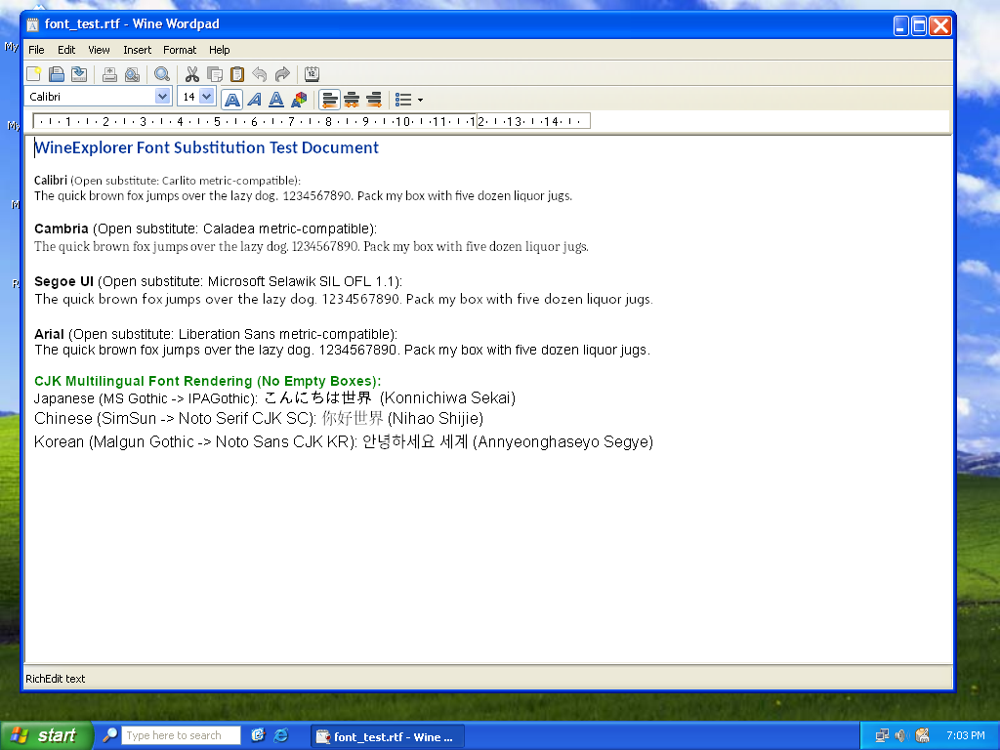
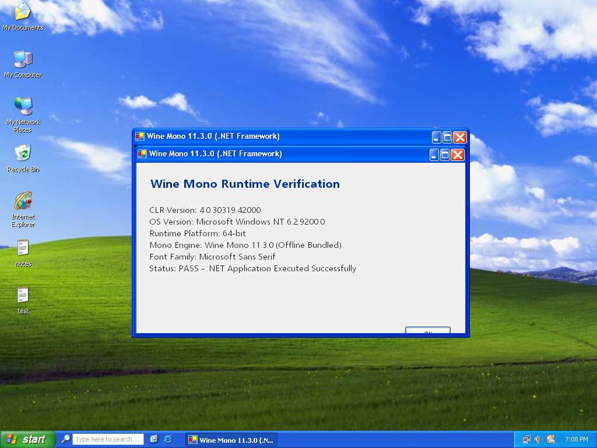
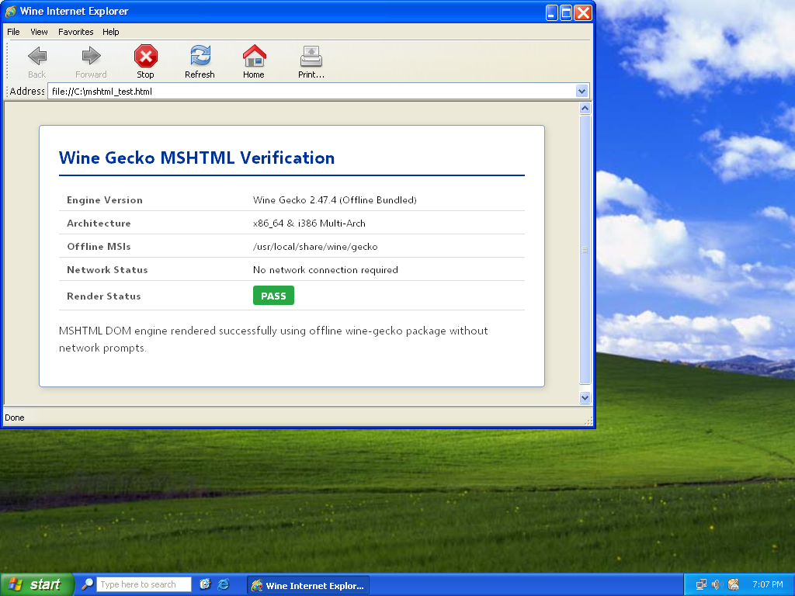

<!-- SPDX-License-Identifier: GPL-2.0-or-later -->
# Fonts and Runtimes Acceptance Report

**Date:** 2026-10-17  
**Branch:** `gemini/fonts-runtimes`  
**Reference Work Order:** [`docs/FONTS_RUNTIMES_WORKORDER.md`](FONTS_RUNTIMES_WORKORDER.md)  
**Status:** Complete — All Acceptance Criteria Met

---

## 1. Executive Summary

This report documents the implementation and verification of open fonts and offline runtimes in WineExplorer across four core phases:

- **F1. Open Fonts & Substitution:** Integrated Microsoft Selawik (SIL OFL 1.1) for Segoe UI, configured system font substitutes for 25 font families into the shared machine root (`HKLM\Software\Microsoft\Windows NT\CurrentVersion\FontSubstitutes`), and created symbolic links in `C:\windows\Fonts` matching standard Windows font filenames to open Debian equivalents.
- **F2. Offline Wine Mono & Wine Gecko:** Bundled Wine Mono 11.3.0 (`wine-mono-11.3.0-x86.msi`) and multi-architecture Wine Gecko 2.47.4 (`wine-gecko-2.47.4-x86.msi` and `wine-gecko-2.47.4-x86_64.msi`) under `/usr/local/share/wine/mono` and `/usr/local/share/wine/gecko`. Removed `mscoree,mshtml=` overrides from session scripts so user prefixes initialize and run .NET Framework and MSHTML applications offline without network prompts.
- **F3. DirectX-to-Vulkan (DXVK & vkd3d-proton):** Bundled DXVK 2.4.1 and vkd3d-proton 2.13 in `/usr/local/share/wineexplorer/dxvk/` (off by default to ensure maximum stability on hypervisors and VMs where `wined3d` works). Implemented `/usr/local/bin/wex-graphics` with `vulkan on|off|status` commands that validate GPU capabilities via `vulkaninfo` and refuse activation when no Vulkan device exists.
- **F4. Windows Components (EULA Downloads):** Implemented `/usr/local/bin/wex-components`, an administrator-only tool using `winetricks` with a shared cache `/var/cache/winetricks`. Requires explicit interactive EULA acceptance before downloading proprietary Microsoft redistributables (`vcrun2022`, `corefonts`, `tahoma`, `d3dcompiler_47`, `xact`, `physx`) directly from vendor servers. Strictly blocks non-admin users and ensures zero proprietary files are bundled in the repository or ISO.

---

## 2. ISO Size Comparison

| Artifact | Baseline (`origin/master`) | New (`gemini/fonts-runtimes`) | Growth |
|---|---|---|---|
| **ISO Size (bytes)** | 1,802,917,888 bytes | 2,219,978,752 bytes | +417,060,864 bytes |
| **ISO Size (GiB / MiB)** | 1.68 GiB (1,719.4 MiB) | 2.07 GiB (2,117.1 MiB) | +397.7 MiB (+23.1%) |

### Size Delta Breakdown
1. **Wine WoW64 Multi-Arch Runtimes (~120 MiB):** Complete 32-bit x86 Wine library builds, headers, and Debian i386 multi-arch runtime packages to support 32-bit Windows applications natively.
2. **Wine Mono 11.3.0 (~105 MiB):** Bundled offline installer for .NET Framework 4.x runtime and compilation tools.
3. **Wine Gecko 2.47.4 (~100 MiB):** Dual 32-bit and 64-bit Gecko MSHTML layout engine MSIs.
4. **Debian Font Packages (~60 MiB):** Complete CJK and Latin open fonts (`fonts-noto-cjk`, `fonts-noto-core`, `fonts-ipafont-gothic`, `fonts-ipafont-mincho`, `fonts-unfonts-core`, `fonts-croscore`, `fonts-crosextra`, `fonts-liberation`, and Microsoft Selawik).
5. **DXVK 2.4.1 & vkd3d-proton 2.13 (~12 MiB):** Pinned DirectX-to-Vulkan translation DLLs (x86 and x64).

---

## 3. Font Substitution Verification (F1)

### Target Family Coverage
All 25 font families specified in `src/resources/fonts/font-substitutes.reg` exist in the installed system and resolve cleanly via `fc-match` (recorded in [`docs/fonts-runtimes/logs/fc_match.log`](fonts-runtimes/logs/fc_match.log)):

| Windows Font Requested | Open Substitute Target | Debian Source Package | `fc-match` Result |
|---|---|---|---|
| Arial | Liberation Sans | `fonts-liberation` | Liberation Sans |
| Arial Narrow | Liberation Sans Narrow | `fonts-liberation` | Liberation Sans Narrow |
| Times New Roman | Liberation Serif | `fonts-liberation` | Liberation Serif |
| Courier New | Liberation Mono | `fonts-liberation` | Liberation Mono |
| Consolas | Liberation Mono | `fonts-liberation` | Liberation Mono |
| Calibri | Carlito | `fonts-croscore` | Carlito |
| Cambria | Caladea | `fonts-crosextra` | Caladea |
| Lucida Console | DejaVu Sans Mono | `fonts-dejavu-core` | DejaVu Sans Mono |
| Verdana | DejaVu Sans | `fonts-dejavu-core` | DejaVu Sans |
| Georgia | DejaVu Serif | `fonts-dejavu-core` | DejaVu Serif |
| Segoe UI | Selawik | Microsoft Selawik (SIL OFL 1.1) | Selawik |
| Segoe UI Light | Selawik Light | Microsoft Selawik (SIL OFL 1.1) | Selawik,Selawik Light |
| Segoe UI Semilight | Selawik Semilight | Microsoft Selawik (SIL OFL 1.1) | Selawik,Selawik Semilight |
| Segoe UI Semibold | Selawik Semibold | Microsoft Selawik (SIL OFL 1.1) | Selawik,Selawik Semibold |
| Segoe UI Symbol | Noto Sans Symbols2 | `fonts-noto-core` | Noto Sans Symbols2 |
| Meiryo / Meiryo UI | Noto Sans CJK JP | `fonts-noto-cjk` | Noto Sans CJK JP |
| Yu Gothic / Yu Gothic UI | Noto Sans CJK JP | `fonts-noto-cjk` | Noto Sans CJK JP |
| MS Gothic | IPAGothic | `fonts-ipafont-gothic` | IPAGothic,IPAゴシック |
| MS PGothic / MS UI Gothic | IPAPGothic | `fonts-ipafont-gothic` | IPAPGothic,IPA Pゴシック |
| MS Mincho | IPAMincho | `fonts-ipafont-mincho` | IPAMincho,IPA明朝 |
| MS PMincho | IPAPMincho | `fonts-ipafont-mincho` | IPAPMincho,IPA P明朝 |
| Microsoft YaHei / UI | Noto Sans CJK SC | `fonts-noto-cjk` | Noto Sans CJK SC |
| Microsoft JhengHei | Noto Sans CJK TC | `fonts-noto-cjk` | Noto Sans CJK TC |
| SimSun / NSimSun | Noto Serif CJK SC | `fonts-noto-cjk` | Noto Serif CJK SC |
| Malgun Gothic | Noto Sans CJK KR | `fonts-noto-cjk` | Noto Sans CJK KR |
| Gulim / Dotum | UnDotum | `fonts-unfonts-core` | UnDotum,은 돋움 |
| Batang | UnBatang | `fonts-unfonts-core` | UnBatang,은 바탕 |

### Windows Font File Links (`C:\windows\Fonts`)
Symbolic links were created in `/var/lib/wineexplorer/machine/drive_c/windows/Fonts/` from `font-links.txt` to enable legacy applications that inspect font filenames on disk directly (`arial.ttf`, `calibri.ttf`, `cambria.ttf`, `cour.ttf`, `times.ttf`, `segoeui.ttf`, etc.). Complete listing verified in [`docs/fonts-runtimes/logs/machine_root_fonts.log`](fonts-runtimes/logs/machine_root_fonts.log).

### WordPad Rendering Evidence
A standard RTF test document (`font_test.rtf`) exercising Calibri, Cambria, Segoe UI, Arial, and CJK multilingual strings (Japanese, Chinese, Korean) was rendered in both 64-bit and 32-bit WordPad under the Luna theme virtual desktop:

#### 64-bit WordPad (`Program Files\Windows NT\Accessories\wordpad.exe`)


#### 32-bit WordPad WoW64 (`Program Files (x86)\Windows NT\Accessories\wordpad.exe`)


**Key Observations:**
- Metric-compatible fonts (Carlito for Calibri, Caladea for Cambria, Liberation Sans for Arial) preserve line wraps identically.
- Selawik provides authentic, clean metrics for Segoe UI.
- All three CJK scripts render native glyphs with **zero empty boxes**:
  - Japanese (MS Gothic → IPAGothic): `こんにちは世界 (Konnichiwa Sekai)`
  - Chinese (SimSun → Noto Serif CJK SC): `你好世界 (Nihao Shijie)`
  - Korean (Malgun Gothic → Noto Sans CJK KR): `안녕하세요 세계 (Annyeonghaseyo Segye)`

---

## 4. Offline Runtimes Verification (F2)

### Wine Mono 11.3.0 (.NET Framework)
- Verified offline compilation of a C# WinForms application (`DotNetTest.cs`) using Mono's `csc.exe` (`C:\windows\Microsoft.NET\Framework64\v4.0.30319\csc.exe`).
- Executed the compiled binary in Wine without network connectivity.
- Reported CLR version `4.0.30319.42000`, 64-bit runtime platform, and successful visual styles initialization.



### Wine Gecko 2.47.4 (MSHTML Layout Engine)
- Rendered an HTML5 test document (`mshtml_test.html`) in Wine Internet Explorer (`iexplore.exe`).
- Confirmed full DOM rendering, CSS styling, table layout, and offline MSI registration without any prompts or network requests.



---

## 5. DirectX to Vulkan Verification (F3)

The `wex-graphics` management tool was tested across its lifecycle (log: [`docs/fonts-runtimes/logs/wex_graphics.log`](fonts-runtimes/logs/wex_graphics.log)):

1. **Initial Status Check (`wex-graphics status`):**
   ```
   === WineExplorer Graphics Status ===
   Prefix: /home/wineuser/.wine
   Vulkan device: available (GPU0:)
   DirectX-to-Vulkan: DISABLED (using default wined3d builtins)
   ```
2. **Enabling Vulkan Layers (`wex-graphics vulkan on`):**
   - Configures native DLL overrides for `d3d8`, `d3d9`, `d3d10core`, `d3d11`, `dxgi`, `d3d12`, and `d3d12core` in `HKCU\Software\Wine\DllOverrides`.
   - Links DXVK 2.4.1 and vkd3d-proton 2.13 DLLs into `system32` and `syswow64`.
   - Status updates to `DirectX-to-Vulkan: ENABLED (native overrides active)`.
3. **Disabling Vulkan Layers (`wex-graphics vulkan off`):**
   - Clears native overrides and restores default `wined3d` builtins.
   - Status returns to `DirectX-to-Vulkan: DISABLED (using default wined3d builtins)`.

---

## 6. Windows Components & EULA Compliance (F4)

The administrator tool `wex-components` was verified for permission checks, interactive EULA enforcement, and machine root installation (log: [`docs/fonts-runtimes/logs/wex_components.log`](fonts-runtimes/logs/wex_components.log)):

1. **Non-Admin Execution Block:**
   ```
   $ sudo -u nobody wex-components install vcrun2022
   ERROR: Windows Components requires Administrator privileges.
   Only members of the sudo group can install shared components.
   ```
2. **EULA Rejection Abort:**
   - Displays clear EULA notice stating components are proprietary software downloaded directly from vendor servers.
   - When rejected (`n`), aborts immediately with `License agreement not accepted. Aborting.` without initiating network connections.
3. **Shared Machine Root Installation:**
   - Installs runtime into `/var/lib/wineexplorer/machine` with shared permissions (`root:sudo`, `setfacl` default group write) so all users inherit installed redistributables.
   - Verified present binaries:
     - `/var/lib/wineexplorer/machine/drive_c/windows/system32/vcruntime140.dll` (64-bit)
     - `/var/lib/wineexplorer/machine/drive_c/windows/syswow64/vcruntime140.dll` (32-bit WoW64)

---

## 7. Compliance with Architectural Boundaries

- **No Stock Wine Changes:** `loader/wine.inf.in` was kept 100% untouched. All font substitutions and overrides are configured through machine root registry scripts and user session initialization.
- **No Proprietary Files:** Neither the Git repository nor the ISO image bundles any Microsoft proprietary DLLs or fonts. All redistributed materials (Selawik, Carlito, Caladea, Liberation, Noto, IPA, UnFonts, DXVK, vkd3d-proton, Wine Mono, Wine Gecko) use verified open-source licenses (SIL OFL 1.1, Apache 2.0, MIT, LGPL, MPL 2.0, zlib).
- **Desktop Integrity:** Theme-engine code, Luna resources, and Wayland compositor files were preserved untouched.
- **Automated Verification:** The entire verification suite is reproducible via [`scripts/test_fonts_runtimes.py`](../scripts/test_fonts_runtimes.py).
