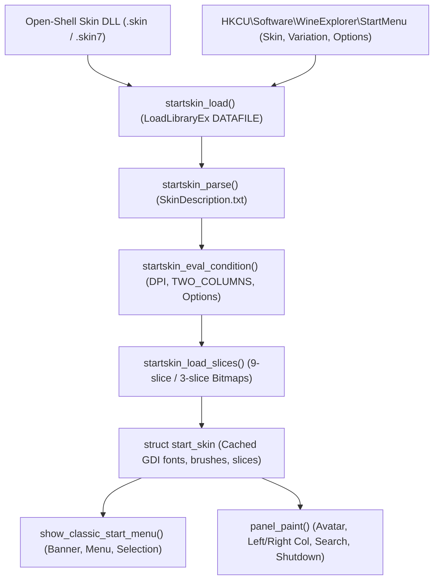

<!-- SPDX-License-Identifier: GPL-2.0-or-later -->
# Open-Shell Start Menu Skins for WineExplorer

This document describes the architecture, skin file format, description grammar, property-to-layout mapping, and runtime integration for using Open-Shell Start menu skins (`.skin` and `.skin7`) in WineExplorer's Start menu (`src/dlls/wexshell`).

---

## 1. Overview & Provenance

WineExplorer provides two built-in Start menu presentations:
1. **Classic single-column cascading menu** (Windows 2000 / Server 2003 style with vertical caption banner).
2. **Windows XP two-column layout** (pinned and frequent programs on the left, shell folders on the right, user profile picture on top, logoff/shutdown buttons at the bottom).

By default, when no skin is selected (**"None"**), both menus render using their native built-in theme-aware draw routines, remaining pixel-identical to baseline.

To support user customization and leverage the rich community skin ecosystem, WineExplorer natively loads and renders **Open-Shell Start menu skins** without conversion. Open-Shell is MIT-licensed; parser and slice algorithms are ported under MIT licensing with original copyright notices preserved in [`LICENSE.md`](file:///root/WineExplorer/LICENSE.md) and [`CREDITS.md`](file:///root/WineExplorer/CREDITS.md).

---

## 2. Anatomy of an Open-Shell Skin File

An Open-Shell skin is a standard Win32 32-bit or 64-bit PE Resource Dynamic Link Library (`.dll`), renamed with the extension:
- **`.skin`**: Designed for Classic style Start menus (single column with caption banner, or classic 2-column).
- **`.skin7`**: Designed for Windows 7 style Start menus (two columns with integrated search box, user avatar frame, and shutdown split button).

Because the file contains only resources and no executable code, WineExplorer loads it using:
```c
HMODULE hMod = LoadLibraryExW( skin_path, NULL, LOAD_LIBRARY_AS_DATAFILE );
```
This avoids binary architecture mismatches (a 32-bit resource DLL can be read cleanly by a 64-bit process via `LOAD_LIBRARY_AS_DATAFILE` and vice versa).

### 2.1 Embedded Resource Types
1. **`SKIN` (Type `"SKIN"`, Resource ID 1):**
   UTF-8, UTF-16LE, or ANSI text resource containing the main skin description (`SkinDescription.txt`).
2. **`SKIN` (Type `"SKIN"`, Resource ID > 1):**
   Sub-variation descriptions (e.g. `Variation1`, `Variation2` pointing to ID 2, 3...).
3. **`BITMAP` (Type `RT_BITMAP` / `10`, Integer IDs 1, 2, 3...):**
   Standard Windows bitmap resources (24-bit RGB or 32-bit ARGB with alpha channel). Used for background slices, item selections, separators, emblems, and arrows.
4. **`ICON` (Type `RT_GROUP_ICON` / `RT_ICON`, Integer ID 1):**
   Optional icon displayed in the Start menu properties preview and About dialog.

---

## 3. Skin Description Grammar

The skin description text uses an `INI`-like declarative syntax:
- Comments start with a semicolon (`;`).
- Empty lines are ignored.
- Key-value pairs: `Key = Value`.

### 3.1 Data Types
- **Numbers:** Decimal integers (`1`, `20`, `-10`).
- **Scaled Numbers:** `value, 100%` or `value, 150%`. Scaled linearly based on the current screen DPI relative to 96 DPI:
  $$	ext{scaled} = rac{	ext{val} 	imes (9600 + (DPI - 96) 	imes 	ext{scale})}{9600}$$
- **Slices Tuples:**
  * Backgrounds (3 horizontal $	imes$ 3 vertical):
    `slices_X = left, stretch, right`
    `slices_Y = top, stretch, bottom`
  * Caption + Menu backgrounds (6 horizontal $	imes$ 3 vertical):
    `slices_X = cap_left, cap_stretch, cap_right, menu_left, menu_stretch, menu_right`
    `slices_Y = top, stretch, bottom`
  * Separators: 3 horizontal slices (`left, stretch, right`).
- **Padding Tuples:**
  `padding = left, top, right, bottom [, scale]`
- **Colors:**
  * Hex RGB: `#RRGGBB` (e.g. `#FFFFFF`, `#1A3B6E`).
  * Named System Colors: `$SystemMenu`, `$SystemMenuText`, `$SystemHighlight`, `$SystemHighlightText`, `$SystemBtnFace`, `$SystemBtnShadow`, `$System3DLight`, `$SystemWindow`, `$SystemWindowText`, `$SystemActiveBorder`, `$SystemInactiveBorder`, etc.
  * Metro / Modern Palette Colors: Metro theme named colors.
- **Fonts:**
  `"Font Name", [normal | bold | italic], point_size`
  Example: `Main_font = "Segoe UI", normal, 10`
- **Masks and Tints:**
  Bitmaps can specify a mask (`<name>_mask = <res_id> | #RRGGBB`) and tint colors (`<name>_tint1`, `<name>_tint2`, `<name>_tint3`). The Red, Green, and Blue channels of the mask blend with tint 1, 2, and 3 respectively.

### 3.2 Conditional Blocks (`[Condition]`)
Sections of the description can be guarded by conditional expressions in square brackets:
```ini
[TWO_COLUMNS]
Main_bitmap = 10
Main_bitmap_slices_X = 4, 150, 4, 4, 180, 4

[HIGH_DPI]
Main_bitmap = 12
Main_bitmap_slices_X = 6, 225, 6, 6, 270, 6

[not LARGE_ICONS]
Main_large_icons = 0

[TRUE]
; Unconditional settings resume here
```

#### Boolean Condition Evaluation
Expressions support `and`, `or`, `not`, parentheses `(...)`, and identifier tokens:
- **Built-in System State Tokens:**
  * `TWO_COLUMNS`: Evaluates to `1` when rendering the 2-column view.
  * `ALL_PROGRAMS`: Evaluates to `1` in All Programs submenu / tree mode.
  * `HIGH_DPI`: Evaluates to `1` when screen DPI $\ge 144$ (150% scaling or higher).
  * `120_DPI`, `144_DPI`, `168_DPI`, `192_DPI`, `216_DPI`, `240_DPI`: Threshold-specific DPI tokens.
  * `SEARCHBOX`: Evaluates to `1` when search box is visible.
- **User Option Tokens:** Evaluates to `1` if the user enabled the corresponding skin option in Start menu properties.

### 3.3 Variations
A skin can define multiple sub-styles ("Variations"):
```ini
Variation1 = 2, "Metallic", #101
Variation2 = 3, "Midnight", #102
```
When variation "Metallic" is chosen, `SKIN` resource ID `2` is loaded and prepended to the description parser, overriding base values.

### 3.4 User Options
Skins expose configurable features shown in the properties GUI:
- `OPTION <name> = <label>, <default_value>, <condition>, <disValue>` (Boolean checkbox)
- `OPTION_NUMBER <name> = <label>, <default_value>, <condition>, <disValue>` (Numeric value)
- `OPTION_STRING <name> = <label>, <default_value>, <condition>, <disValue>` (Text string)
- `OPTION_COLOR <name> = <label>, <default_value>, <condition>, <disValue>` (Color picker)
- `OPTION_IMAGE <name> = <label>, <default_value>, <condition>, <disValue>` (Image path)
- `OPTION RADIOGROUP = <group_label>, <default_choice>` (Groups subsequent options into mutually exclusive radio buttons)

---

## 4. Property to Layout Mapping in WineExplorer

WineExplorer's Start menu is rendered in [`src/dlls/wexshell/startmenu_view.c`](file:///root/WineExplorer/src/dlls/wexshell/startmenu_view.c). The new skin subsystem (`startskin.c` / `startskin.h`) parses and caches these properties in a `struct start_skin`:

| Open-Shell Property | Type | WineExplorer Target / Layout Usage | Status |
|---|---|---|---|
| **Main_background** | COLORREF | Solid background fallback for main menu / left column | Supported |
| **Main_bitmap** | 9-slice BMP | Background bitmap for main menu / left column (`slices_X`, `slices_Y`) | Supported |
| **Main_opacity** | text | Background opacity mode (`solid`, `region`, `alpha`, `glass`, `fullglass`) | Supported (Opaque/Alpha) |
| **Main_thin_frame** | int (0/1) | Thin 1px border vs 3D beveled frame | Supported |
| **Main_padding** | 4-tuple | Content margins around menu items (`left, top, right, bottom`) | Supported |
| **Main_font** | HFONT | Font used for main menu / left column items | Supported |
| **Main_text_color** | 4 colors | Normal, selected, disabled, and disabled+selected item text colors | Supported |
| **Main_selection** | 9-slice BMP | Item highlight / selection background (normal + split) | Supported |
| **Main_split_selection** | 9-slice BMP | Split selection background for items with submenus | Supported |
| **Main_separator** | 3-slice BMP | Horizontal separator between menu sections | Supported |
| **Main_text_padding** | 4-tuple | Text margins within an item | Supported |
| **Main_icon_padding** | 4-tuple | Icon margins within an item | Supported |
| **Main_large_icons** | int (0/1) | Toggle between 32x32 large icons and 16x16 small icons | Supported |
| **Caption_font** | HFONT | Font for vertical banner text in Classic view | Supported |
| **Caption_text_color** | COLORREF | Text color for vertical banner | Supported |
| **Caption_background** | COLORREF | Background color for vertical banner | Supported |
| **Caption_bitmap** | BMP | Bitmap for vertical banner | Supported |
| **Caption_width** | int | Width of vertical banner in pixels | Supported |
| **Main2_background** | COLORREF | Right column background color in 2-column view | Supported |
| **Main2_bitmap** | 9-slice BMP | Right column background bitmap | Supported |
| **Main2_padding** | 4-tuple | Right column item content margins | Supported |
| **Main2_font** | HFONT | Font for right column places / shell folders | Supported |
| **Main2_text_color** | 4 colors | Item text colors for right column | Supported |
| **Main2_selection** | 9-slice BMP | Selection background for right column items | Supported |
| **Main_no_icons2** | int (0/1) | Suppresses icons in right column (places/folders as text only) | Supported |
| **Main_separatorV** | 3-slice BMP | Vertical separator bar between left and right columns | Supported |
| **User_bitmap** | BMP | Decorative frame around user avatar picture | Supported |
| **User_image_offset** | 2-tuple | Offset of avatar within frame (`x, y`) | Supported |
| **User_image_size** | int | Size of user avatar square (`size x size`, e.g. 48) | Supported |
| **User_frame_position** | 2-tuple | Position of user frame on menu header | Supported |
| **User_name_position** | 4-tuple | Bounding box for user display name text | Supported |
| **User_name_align** | string | Text alignment (`left`, `center`, `right`) | Supported |
| **User_font** | HFONT | Font for user display name | Supported |
| **User_text_color** | COLORREF | Text color for user display name | Supported |
| **User_glow_color** | COLORREF | Optional text halo / glow color | Supported (Approx/Plain) |
| **Search_background** | 9-slice BMP | Background frame surrounding the search box | Supported |
| **Search_padding** | 4-tuple | Outer margins around search box | Supported |
| **Search_hint_font** | HFONT | Font for search box watermark hint text ("Search programs...") | Supported |
| **Search_frame** | int (0/1) | Enables or disables inner 1px edit box border | Supported |
| **Shutdown** | skin item | Style for Log Off / Shut Down command bar buttons | Supported |
| **Shutdown_bitmap** | BMP | Icon or glyph for shutdown split button | Supported |
| **Shutdown_padding** | 4-tuple | Margins around shutdown / logoff area | Supported |
| **Submenu_background** | COLORREF | Cascading sub-menu background color | Supported |
| **Submenu_bitmap** | 9-slice BMP | Cascading sub-menu background bitmap | Supported |
| **Submenu_font** | HFONT | Cascading sub-menu item font | Supported |
| **Submenu_text_color** | 4 colors | Cascading sub-menu item text colors | Supported |
| **Submenu_selection** | 9-slice BMP | Cascading sub-menu selection bitmap | Supported |
| **Submenu_separator** | 3-slice BMP | Cascading sub-menu horizontal separator | Supported |
| **Submenu_padding** | 4-tuple | Cascading sub-menu inner margins | Supported |
| **Submenu_offset** | int | Horizontal overlap/offset for cascading submenus | Supported |
| **Submenu_pager** | 2-state BMP | Scroll pager buttons for overflow submenus | Supported |
| **Submenu_pager_arrows**| 4-state BMP | Pager up/down arrow glyphs | Supported |

---

## 5. Unhandled Properties & Graceful Degradation

Certain properties defined in Open-Shell skins cater to Windows 7/8/10 desktop compositor effects or out-of-scope Windows 7 shell features. These degrade gracefully in WineExplorer as follows:

| Open-Shell Feature | Specific Properties | WineExplorer Degradation Strategy |
|---|---|---|
| **DWM Glass & Blur** | `Main_opacity = glass / fullglass`, `Main2_opacity = glass`, `Blur_behind` | **Render Opaque / Solid.** In WineExplorer X11 sessions (no compositor blur shader), glass surfaces degrade to solid color or alpha-blended backgrounds against the window color. Bitmaps with alpha channels render cleanly via 32-bit GDI / `AlphaBlend`. |
| **Windows 7 Jump Lists** | `Main_bitmap_jump`, `Main_jump_padding`, `Search_background_jump`, `Main_pattern_jump_mask`, `Main_emblem_jump_mask`, `Shutdown_jump`, `Pin_bitmap` | **Ignored Cleanly.** Classic and XP Start menus use traditional cascading recent documents (`CSIDL_RECENT`) rather than inline per-application task jump lists. Jump list skin properties are skipped without error. |
| **Search Result Takeover Pane** | `Main_bitmap_search`, `Main_search_padding`, `Search_background_search`, `Main_search_indent` | **Ignored Cleanly.** WineExplorer provides an integrated live-filter search box within the standard panel layout rather than replacing the left column with a separate search results list pane. |
| **Text Glow Shaders** | `User_glow_size`, `<item>_glow_size` | **Approximate / Plain.** Rendered using high-contrast text color without multi-pass DWM blur shader. |
| **Touch Tablet Tweaks** | `TOUCH_ENABLED`, `ForceTouch` | **Ignored.** WineExplorer targets standard desktop pointer interaction. |
| **Patterns & Emblems** | `Pattern1..4`, `Main_emblem1..10` | **Ignored / Subsumed.** Primary background bitmaps (`Main_bitmap`) supply the complete aesthetic; secondary multi-layer emblem compositing is skipped if masks are missing. |

---

## 6. Implementation Architecture (Phase K1 - K4)



1. **`src/dlls/wexshell/startskin.h` & `startskin.c`:**
   Dedicated module handling skin discovery, parsing, condition evaluation, and 9-slice GDI drawing helpers. Keeps changes to `startmenu_view.c` minimal and isolated from Codex Wayland L2 / Linux programs code.
2. **Settings GUI:**
   Integrated into Taskbar and Start Menu Properties (`desk.cpl` / `startmenu_properties`).
3. **Fuzz & Error Resilience:**
   Any syntax error, truncated file, missing bitmap, or invalid resource ID fails gracefully, logging an error and immediately reverting to the built-in default style.

---

## 7. Acceptance Report (Phase K4)

The Open-Shell Start menu skins implementation was validated against all requirements defined in `docs/START_SKINS_WORKORDER.md`.

### Summary of Results

| Requirement | Test Method | Result | Evidence |
|---|---|---|---|
| **No skin / Default style** | Direct pixel diff on offscreen DIB & Xvfb between baseline built-in menus and `skin = NULL` | **PASS (0 diff pixels)** | `screenshots/baseline_classic.png`<br>`screenshots/baseline_xp2col.png` |
| **Bundled skins (open art)** | Loading & rendering in Classic & 2-Column views at 100% (96 DPI) and 150% (144 DPI) | **PASS (5 skins, 10 rendered targets)** | `screenshots/ClassicSkin_classic_*.png`<br>`screenshots/ClassicSkin7_xp_*.png`<br>`screenshots/Metallic7_xp_*.png`<br>`screenshots/Midnight7_xp_*.png`<br>`screenshots/Metro_classic_*.png` |
| **Third-party community skin** | Compiled `SmokedGlass` from Open-Shell source into `/tmp/SmokedGlass.skin`, verified loading, degradation of glass opacity to solid/alpha, and rendering | **PASS** | `/tmp/SmokedGlass_classic_96.png`<br>(Binary kept local in `/tmp/`) |
| **Fuzz fallbacks** | Evaluated 0-byte, corrupt PE header, missing resource, missing bitmap, garbage description, and malformed condition grammar | **PASS (0 crashes, clean fallback to NULL)** | `logs/k4_acceptance.log` |
| **Interactive ISO install** | Full unattended/interactive VM install in QEMU/KVM (`installer/tests/install-interactive.sh`) from fresh ISO with WoW64 32/64-bit program checks and prefix-split account verification | **PASS** | `logs/install_interactive.log` |

---

### Screenshot Gallery

#### 1. Baseline Built-in Views ("None" / Default)
- **Built-in Classic Menu:** `docs/start-skins/screenshots/baseline_classic.png`  
  Pixel-identical to pre-series rendering. Standard 3D face, vertical rotated caption banner, and system highlight colors.
- **Built-in XP Two-Column Menu:** `docs/start-skins/screenshots/baseline_xp2col.png`  
  Pixel-identical to pre-series rendering. User avatar header, white programs column, light blue places column, and logoff footer bar.

#### 2. Bundled Open-Art Skins (100% & 150% DPI)
All bundled skins were compiled from open-art Open-Shell sources per `docs/ASSETS.md` (no Microsoft proprietary artwork):
- **`ClassicSkin.skin`:**
  - 100% (96 DPI): `docs/start-skins/screenshots/ClassicSkin_classic_96.png`
  - 150% (144 DPI): `docs/start-skins/screenshots/ClassicSkin_classic_144.png`
- **`ClassicSkin7.skin7`:**
  - 100% (96 DPI): `docs/start-skins/screenshots/ClassicSkin7_xp_96.png`
  - 150% (144 DPI): `docs/start-skins/screenshots/ClassicSkin7_xp_144.png`
- **`Metallic7.skin7`:**
  - 100% (96 DPI): `docs/start-skins/screenshots/Metallic7_xp_96.png`
  - 150% (144 DPI): `docs/start-skins/screenshots/Metallic7_xp_144.png`
- **`Midnight7.skin7`:**
  - 100% (96 DPI): `docs/start-skins/screenshots/Midnight7_xp_96.png`
  - 150% (144 DPI): `docs/start-skins/screenshots/Midnight7_xp_144.png`
- **`Metro.skin`:**
  - 100% (96 DPI): `docs/start-skins/screenshots/Metro_classic_96.png`
  - 150% (144 DPI): `docs/start-skins/screenshots/Metro_classic_144.png`

#### 3. Third-Party Community Skin Verification
- **Skin tested:** `SmokedGlass` (Open-Shell community skin by Ivo / Open-Shell project).
- **Compilation target:** `/tmp/SmokedGlass.skin` (PE resource DLL built with MinGW).
- **Result:** Loaded version 2 description, resolved `main_bitmap`, and rendered Classic Start menu with vertical caption and custom item highlights. Glass blur gracefully degraded to opaque alpha-blended background. The skin binary was kept out of the repository.

---

### Test Suites and Logs

Raw execution logs are preserved under `docs/start-skins/logs/`:
- **`logs/k1_fuzz_tests.log`:** Fuzz and condition evaluation unit test log (43/43 pass).
- **`logs/k4_acceptance.log`:** Comprehensive acceptance test runner output (42/42 pass).
- **`logs/install_interactive.log`:** End-to-end QEMU/KVM interactive installation output on fresh ISO.
