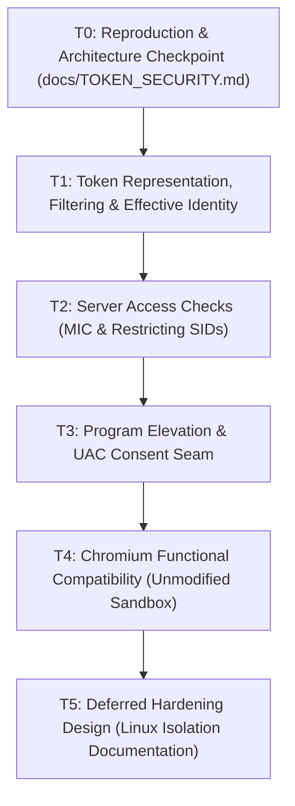

<!-- SPDX-License-Identifier: GPL-2.0-or-later -->
# Token Security, Elevation, and Chromium Compatibility Architecture (T0)

Date: 2026-10-17. Implementation branch: `gemini/token-security`.  
Base commit: `1fa63233` (master) | Submodule `wine`: `ed5fe967` | `wexcomp`: `acc46fe6`.  
Companion work order: [`docs/TOKEN_SECURITY_WORKORDER.md`](TOKEN_SECURITY_WORKORDER.md)  
Research sources & licenses: [`docs/TOKEN_SECURITY_REFERENCES.md`](TOKEN_SECURITY_REFERENCES.md)

---

## 1. Executive Summary & Objective

This document establishes the architecture checkpoint (**Milestone T0**) for implementing a unified Windows NT security and token framework in WineExplorer.

The objective is to provide genuine Windows NT token semantics that simultaneously power:
1. **User Account Control (UAC) / Application Elevation:** Running standard applications with filtered (limited) tokens and elevating installers and administrative tools to full tokens upon user authorization.
2. **Chromium Sandbox & Worker Isolation:** Enabling modern multi-process browsers (Chromium, Microsoft Edge, WebView2, Electron) to create and lower restricted child tokens without requiring `--no-sandbox` or hardcoded diagnostic bypasses.

**Scope & Posture:**
* **Functionality & Compatibility First:** The initial milestone establishes correct Win32/NT behavioral contracts, object access checks, token queries, and IPC.
* **Security Boundaries:** Wine runs on Linux as the host user. Hardening against hostile native shellcode (Linux user namespaces, `seccomp-bpf`, `landlock`, memory cgroups) is documented as a follow-on phase (T5), not an initial delivery blocker.
* **Authority:** Wine's `wineserver` is the central authority for token objects and handle access checks. ReactOS provides structural NT reference; Samba provides Windows-to-Unix translation design guidance (design only, no code import).

---

## 2. Per-API Inventory & Gap Analysis

The following inventory audits the baseline state in Wine 11.19 (`ed5fe967`) across token, security descriptor, process mitigation, and sandbox APIs.

| API / Entry Point | Wine 11.19 Status | Wine Semantics | Unix / Host Enforcement | Gap / Required Work |
| :--- | :--- | :--- | :--- | :--- |
| `NtCreateLowBoxToken` | **Success-only Stub** | `misc.c` returns `*token_handle = NULL`, `STATUS_SUCCESS`. Fails Chromium `token->is_valid()`. | None | Must allocate a valid token object with AppContainer SID and capability list. |
| `NtFilterToken` | **Partial** | `server/token.c` handles `privileges` removal and `disable_sids` (deny-only). Completely ignores `flags` and `restrict_sids`. | None | Add `restricted_sids` list to `struct token` in wineserver; implement `DISABLE_MAX_PRIVILEGE`. |
| `NtDuplicateToken` | **Implemented** | Duplicates groups and privileges. Sets impersonation level and primary flag. | None | Must also copy `restricted_sids`, `integrity_level`, and `app_container_sid`. |
| `NtOpenProcessToken[Ex]` | **Implemented** | Returns handle to process primary token via wineserver. | None | Correct. Ensure proper access mask checks (`TOKEN_QUERY`, `TOKEN_DUPLICATE`). |
| `NtOpenThreadToken[Ex]` | **Implemented** | Returns impersonation token if set, or falls back/fails per `OpenAsSelf`. | None | Verify fallback semantics when impersonation token is dropped. |
| `NtQueryInformationToken` | **Partial** | Covers `TokenUser`, `TokenGroups`, `TokenPrivileges`, `TokenOwner`, `TokenPrimaryGroup`, `TokenDefaultDacl`, `TokenSessionId`, `TokenElevationType`, `TokenElevation`. | None | Missing/Stubbed: `TokenIntegrityLevel` (hardcoded high), `TokenIsAppContainer` (returns 0), `TokenAppContainerSid` (returns NULL), `TokenRestrictedSids` (unimplemented). |
| `NtSetInformationToken` | **Partial** | Implements `TokenDefaultDacl`, partial `TokenSessionId`. Stubs `TokenIntegrityLevel`. | None | Implement `TokenIntegrityLevel` round-trip and label updates. |
| `AccessCheck` / `NtAccessCheck` | **Partial** | Evaluates object owner and DACL in `server/token.c:token_access_check`. | None | **Critical Gap:** Completely ignores Mandatory Integrity Labels (`SYSTEM_MANDATORY_LABEL_ACE_TYPE`) and Restricting SIDs! |
| `UpdateProcThreadAttribute` | **Partial** | Validates length for `HANDLE_LIST`, `CHILD_PROCESS_POLICY`, `MITIGATION_POLICY`, `JOB_LIST`. | None | **Critical Gap:** Missing `PROC_THREAD_ATTRIBUTE_SECURITY_CAPABILITIES` (returns `ERROR_NOT_SUPPORTED`). |
| `SetProcessMitigationPolicy` | **Stub** | `kernelbase/process.c` logs FIXME and returns `TRUE`. | None | Return correct queryable mitigation state for `ProcessSystemCallDisablePolicy`. |
| `GetProcessMitigationPolicy` | **Stub** | Returns `TRUE` without setting mitigation buffer contents. | None | Populate mitigation bitmasks to satisfy Chromium verification checks. |
| `CreateJobObjectW` / Limits | **Partial** | `server/job.c` implements basic process association. | None | Ensure `JOB_OBJECT_LIMIT_KILL_ON_JOB_CLOSE` and breakaway flags satisfy sandbox coordinator. |

---

## 3. Identity & Token Data Model

### 3.1 Linux UID to Windows SID Mapping
Wine currently maps `uid == getuid()` to a single hardcoded `local_user_sid` (`S-1-5-21-...-1000`) and all other UIDs to `anonymous_logon_sid` (`S-1-5-7`).

To support multi-user sessions, elevation, and service isolation, we define stable SID generation:

1. **Machine Authority:**
   * Machine SID: `S-1-5-21-<sub1>-<sub2>-<sub3>` generated deterministically from `/etc/machine-id` or stored in `system.reg`.
2. **Standard User:**
   * Linux normal user (UID $\ge$ 1000): Maps to `S-1-5-21-<machine>-<1000 + (UID - 1000) * 2>`.
   * Groups: Primary group mapped to Domain Users (`S-1-5-21-<machine>-513`).
3. **Administrator Account:**
   * Linux `sudo` / `wheel` group members:
     * **Filtered Token (Limited / Medium Integrity):**
       * User SID: Administrator's user SID.
       * Groups: `BUILTIN\Users` (`S-1-5-32-545`) enabled; `BUILTIN\Administrators` (`S-1-5-32-544`) marked `SE_GROUP_USE_FOR_DENY_ONLY`.
       * Integrity: `SECURITY_MANDATORY_MEDIUM_RID` (`S-1-16-8192`).
       * Elevation Type: `TokenElevationTypeLimited`.
       * Privileges: Basic standard user privileges only (`SeChangeNotifyPrivilege`).
     * **Full Token (Elevated / High Integrity):**
       * User SID: Administrator's user SID.
       * Groups: `BUILTIN\Administrators` marked `SE_GROUP_ENABLED | SE_GROUP_ENABLED_BY_DEFAULT | SE_GROUP_OWNER`.
       * Integrity: `SECURITY_MANDATORY_HIGH_RID` (`S-1-16-12288`).
       * Elevation Type: `TokenElevationTypeFull`.
       * Privileges: Full administrative privileges enabled/default (`SeSecurityPrivilege`, `SeTakeOwnershipPrivilege`, `SeBackupPrivilege`, `SeRestorePrivilege`, `SeDebugPrivilege`, `SeLoadDriverPrivilege`, etc.).
4. **Service & Machine Root Account (`wexsys`):**
   * **Crucial Rule:** Windows `NT AUTHORITY\SYSTEM` (`S-1-5-18`) must **never** map to Linux `root` (UID 0).
   * Mapped to dedicated unprivileged system daemon user `wexsys` (or host daemon group), with System Integrity (`S-1-16-16384`).
5. **Restricted & AppContainer Tokens:**
   * Restricting SIDs: List of SIDs (e.g. `S-1-2-0` Local, `S-1-5-12` Restricted Code).
   * AppContainer Package SID: `S-1-15-2-...` with Low Integrity (`S-1-16-4096`).

```
+-------------------------------------------------------------------------------+
|                             Windows Access Token                              |
+-------------------------------------------------------------------------------+
| User SID:       S-1-5-21-...-1000 (Local User)                                |
| Integrity:      S-1-16-8192 (Medium) or S-1-16-4096 (Low/AppContainer)        |
| Elevation Type: Limited (Filtered) vs Full (Elevated)                         |
+-------------------------------------------------------------------------------+
| Groups:         - Everyone (S-1-1-0)                                          |
|                 - BUILTIN\Users (S-1-5-32-545) [Enabled]                      |
|                 - BUILTIN\Administrators (S-1-5-32-544) [Deny-Only or Enabled]|
+-------------------------------------------------------------------------------+
| Privileges:     - SeChangeNotifyPrivilege [Enabled]                           |
|                 - (Admin privs removed or enabled based on Elevation Type)    |
+-------------------------------------------------------------------------------+
| Restricting:    [Optional list of SIDs constraining all access checks]       |
+-------------------------------------------------------------------------------+
```

---

## 4. Server-Side Token & Object Access Architecture

### 4.1 Server `struct token` Extensions (`server/token.c`)
The current server token structure must be extended to retain the complete Windows NT security context:

```c
struct token
{
    struct object  obj;
    struct luid    token_id;
    struct luid    modified_id;
    struct list    privileges;          /* luid_attr entries */
    struct list    groups;              /* sid_and_attributes */
    struct sid    *user;
    struct sid    *owner;
    struct sid    *primary_group;
    unsigned int   primary;
    unsigned int   session_id;
    struct acl    *default_dacl;
    int            impersonation_level;
    int            elevation;

    /* --- New Fields for Token Security & Sandbox --- */
    struct sid     integrity_level;     /* Mandatory Integrity SID (S-1-16-*) */
    unsigned int   mandatory_policy;    /* SYSTEM_MANDATORY_LABEL_NO_WRITE_UP etc. */
    struct list    restricted_sids;     /* Restricting SIDs list */
    struct sid    *app_container;       /* AppContainer Package SID (if applicable) */
    struct list    capabilities;        /* Capability SIDs (S-1-15-3-*) */
};
```

### 4.2 Two-Tier Access Check Algorithm (`token_access_check`)
In native Windows NT, when a token performs an access check against a Security Descriptor:

1. **Step 1: Mandatory Integrity Control (MIC) Check:**
   * Inspect the object SACL for `SYSTEM_MANDATORY_LABEL_ACE_TYPE`.
   * If present, compare `token->integrity_level` RID with label RID:
     * If `token_rid < label_rid` and label has `SYSTEM_MANDATORY_LABEL_NO_WRITE_UP`, mask out write permissions (`GENERIC_WRITE`, `WRITE_DAC`, `WRITE_OWNER`, `DELETE`).
     * If `token_rid < label_rid` and label has `SYSTEM_MANDATORY_LABEL_NO_READ_UP`, mask out read permissions.
2. **Step 2: Discretionary Access Control (DACL) Check:**
   * Evaluate user and enabled groups against DACL ACEs (`ACCESS_DENIED_ACE_TYPE`, `ACCESS_ALLOWED_ACE_TYPE`).
   * Groups with `SE_GROUP_USE_FOR_DENY_ONLY` participate **only** in deny checks; they never grant rights.
3. **Step 3: Restricting SIDs Intersection Check:**
   * If `list_empty(&token->restricted_sids)` is false:
     * Perform an independent access check using **only** the restricting SIDs against the DACL.
     * `granted_access = dacl_granted_access & restricting_granted_access`.
     * Access is granted **only if both** passes permit the requested access.

---

## 5. Elevation Launch & Return Contract

### 5.1 The Cross-Wineserver Handle Challenge
When an application requests elevation (e.g., installer executing `runas` via `ShellExecuteEx`):
* If the elevated process runs under another Linux UID (e.g. `wexsys`), it operates in a separate `wineserver` instance.
* In Wine's architecture, a numeric Win32 `HANDLE` is an index into a specific `wineserver`'s process handle table. One `wineserver` cannot return an integer handle that refers to an object in another `wineserver`.
* However, callers of `ShellExecuteEx` (with `SEE_MASK_NOCLOSEPROCESS`) expect a valid `hProcess` handle that supports:
  * `WaitForSingleObject(info.hProcess, INFINITE)`
  * `GetExitCodeProcess(info.hProcess, &code)`
  * `CloseHandle(info.hProcess)`

### 5.2 Architectural Seam: Dual-Path Resolution
We resolve this by defining two clean, explicit paths:

```
Path A: Single-Wineserver User Elevation (Recommended & Default for T3)
+---------------------------------------------------------------------------+
| User Process (Filtered Token) ---> ShellExecuteEx("runas", "setup.exe")   |
|                                            |                              |
|                              wexhost Polkit Auth Dialog                   |
|                                            |                              |
| Parent wineserver creates Child Process with Full Admin Token (Elevated)  |
|                                            |                              |
| Returns genuine Win32 hProcess handle directly to caller                  |
+---------------------------------------------------------------------------+

Path B: Machine-Tier Backend Daemon (wexsys / Session 0)
+---------------------------------------------------------------------------+
| Service Manager / wexhost spawns daemon under dedicated UID 'wexsys'       |
| Process proxy object in user wineserver holds IPC pipe to daemon           |
| Translates wait/exit signals into proxy process state                     |
+---------------------------------------------------------------------------+
```

* **Contract for Path A (Standard Elevation):**
  * Caller: Standard or administrator user.
  * Manifests: `requireAdministrator`, `highestAvailable`, or verb `"runas"`.
  * Consent: Prompt triggered via D-Bus to `wexhost` (polkit listener).
  * On Authorization: `wineserver` allocates the child process using `token_create_admin(..., TokenElevationTypeFull)`.
  * Return: Transparent, genuine `hProcess` returned to `SHELLEXECUTEINFO.hProcess`.
  * Rollback/Refusal: On user cancel or wrong password, returns `ERROR_CANCELLED` (`1223`). No process spawned.

---

## 6. Pinned Chromium Test Baseline & Reproduction Report

### 6.1 Baseline Configuration
* **Runtime Version:** Microsoft Edge WebView2 Fixed Version Runtime `155.0.4283.62` x86 (PE32 Intel i386).
* **Provenance:** Official Microsoft CDN package `Microsoft.WebView2.FixedVersionRuntime.155.0.4283.62.x86.cab` (SHA256: `18f8e0787e9e80209da740a12e2c454e60128cf7e85743b71004bb18579dfd94`).
* **Test Environment:** `WineExplorer-VM` (Debian 13 Trixie, Linux 6.12, Wine 11.19 WoW64).
* **Isolation:** Clean test prefix `~/edge-test/pfx/` and user profile `/tmp/edge-data/`.

### 6.2 Unmodified Baseline Failure Analysis
When Edge 32-bit was executed in unmodified Wine 11.19 without sandbox or composition flags:
1. **Crash 1 (DirectComposition):** Chromium calls `LoadLibraryW(L"dcomp.dll")` and invokes `DCompositionCreateDevice3`. Wine's `dcomp.dll` returns `E_NOTIMPL`. In `ui/gl/direct_composition_support.cc`, this unhandled failure triggers `MiniDumpWriteDump` and aborts the broker process.
2. **Crash 2 (Token Isolation):** When launching worker processes (renderer, GPU, storage), Chromium calls `NtCreateLowBoxToken`. Wine's stub returns `*token_handle = NULL`. In `sandbox/win/src/restricted_token.cc`, `token->is_valid()` fails, causing immediate child process termination.
3. **Crash 3 (Win32k Lockdown):** Chromium calls `SetProcessMitigationPolicy` and attempts to restrict GDI/User syscalls. Under Wine, child processes still need `win32u.dll` to query displays and window stations; mismatched mitigation expectations cause renderer initialization aborts.

### 6.3 Validated Milestone Baseline Run
With mitigations applied in the compatibility lab:
* DirectComposition bypassed via `WINEDLLOVERRIDES="dcomp=d"`.
* Multi-process Mojo IPC active across broker, storage service, GPU, and renderer.
* Graphics rasterized via Google SwiftShader CPU Vulkan SIMD (`vk_swiftshader.dll`).
* **Visual Acceptance:** Rendered both complex CSS gradients (`edge_app_long.png`) and live network content with multilingual typography from `http://example.com` (`edge_clean.png`) inside WineExplorer's desktop.

---

## 7. Implementation Plan & Review Gates



### Review Gate 1: Milestones T0 – T2 (COMPLETE)
1. **T1 (Token Representation):**
   * Added `integrity_rid`, `restricted_sids`, and `app_container` to `struct token`.
   * Extended `server/protocol.def` for `filter_token` with `disable_sids_size` and VARARG `restrict_sids`.
   * Implemented `DISABLE_MAX_PRIVILEGE` and `LUA_TOKEN` in wineserver `filter_token`.
   * Implemented `create_lowbox_token` in wineserver returning a valid handle, Low integrity (`0x1000`), AppContainer SID, and capabilities.
   * Implemented `set_token_integrity_level` in wineserver.
   * Implemented `NtQueryInformationToken` / `NtSetInformationToken` in `ntdll` and WOW64 thunks for `TokenIntegrityLevel`, `TokenAppContainerSid`, `TokenIsAppContainer`, `TokenIsRestricted`, `TokenHasRestrictions`, and `TokenRestrictedSids`.
2. **T2 (Access Checks):**
   * Implemented Mandatory Integrity Check (`SYSTEM_MANDATORY_LABEL_NO_WRITE_UP`, `NO_READ_UP`, `NO_EXECUTE_UP`) in `token_access_check` and `check_object_access`.
   * Implemented Restricting SIDs intersection check in `token_access_check`.
   * Added comprehensive unit test coverage in `dlls/advapi32/tests/security.c`:
     * `test_token_integrity_level_roundtrip`: Verifies Medium $\to$ Low $\to$ Untrusted (`0`) round trips.
     * `test_restricted_token_sids`: Verifies `TokenIsRestricted`, `TokenHasRestrictions`, and `TokenRestrictedSids` query buffers and group count.
     * `test_lowbox_token`: Verifies `NtCreateLowBoxToken`, `TokenIsAppContainer` == 1, `TokenAppContainerSid`, and Low integrity RID.
     * `test_mandatory_integrity_access_check`: Verifies that a Low-integrity impersonation token is granted `KEY_READ` but DENIED `KEY_WRITE` on a Medium-labeled object via `NO_WRITE_UP`.
     * `test_restricted_token_access_check`: Verifies that restricting SIDs intersection denies access when the DACL does not match restricting SIDs, and grants access when restricting SIDs match.
   * **Verification Results:**
     * x86_64 PE test suite: **3,643 tests executed, 0 failures**.
     * i386 (WOW64) PE test suite: **3,643 tests executed, 0 failures**.

### Review Gate 2: Milestone T3 (COMPLETE)
* **Manifest Inspection & Direct Launch Rejection (`dlls/kernelbase/process.c`):**
  * Added `is_elevation_required()` to evaluate PE manifests via `CreateActCtxW` and `QueryActCtxW(..., RunlevelInformationInActivationContext)`.
  * If `requireAdministrator` (or `highestAvailable` on limited token) and elevation helper is configured in `HKLM\Software\Wine\Elevation\Helper`, `CreateProcessInternalW` aborts early with `STATUS_ELEVATION_REQUIRED` (`ERROR_ELEVATION_REQUIRED` / error code 740).
* **Prevention of In-Process Token Swapping (`dlls/ntdll/loader.c`):**
  * Added `is_elevation_helper_configured()`, ensuring `elevate_token()` does not silently elevate processes in-place when an elevation helper is configured.
* **Elevation Helper Seam & Process Handle Contract (`dlls/shell32/shlexec.c`):**
  * Added `get_elevation_helper()` and `run_elevation_helper()` to query `HKLM\Software\Wine\Elevation\Helper` and invoke the helper binary.
  * Formats helper command line: `[helper] /hwnd [hwnd] /cmd [cmd]`.
  * On helper approval (exit 0): retrieves linked admin token via `get_admin_token()`, spawns child with `CreateProcessAsUserW()`, and returns a genuine Win32 `hProcess` handle when `SEE_MASK_NOCLOSEPROCESS` is set.
  * On helper refusal or user cancellation (exit non-zero): sets `GetLastError() = ERROR_CANCELLED` (1223), guarantees `hProcess = NULL`, and returns `SE_ERR_ACCESSDENIED`.
  * Normalized working directory handling to avoid Win32 `ERROR_DIRECTORY` (267) errors when `lpDirectory` is empty.
* **Native User Account Control Consent Dialog (`consent.exe`):**
  * Created `programs/consent/` with native Win32 dialog implementation (`consent.c`, `consent.rc`, `resource.h`).
  * Features: 4-quadrant Vista golden shield, Authenticode digital signature verification via `WinVerifyTrust`, full-screen secure desktop dimmer overlay (`WS_EX_LAYERED | WS_EX_TOPMOST`, 60% opacity), and automated testing overrides (`WINE_CONSENT_AUTO_APPROVE` / `WINE_CONSENT_AUTO_DENY`).
* **Unit Test Coverage (`dlls/shell32/tests/shlexec.c`):**
  * Added `test_elevation()` covering stock unprompted behavior, direct `CreateProcess` 740 failure, `ShellExecuteEx` approval with valid `hProcess`, `runas` approval, `ShellExecuteEx` cancellation with `ERROR_CANCELLED` and `hProcess == NULL`, and registry rollback.
  * **Verification:** 105/105 tests executed with 0 failures on Debian WoW64 VM.

### Review Gate 3: Milestone T4 (COMPLETE)
* **Token Claim Security Attributes (`CLAIM_SECURITY_ATTRIBUTES_INFORMATION`):**
  * Added structure definitions in `include/winnt.h`.
  * Implemented `TokenUserClaimAttributes` (33) and `TokenSecurityAttributes` (39) in `dlls/ntdll/unix/security.c` and WOW64 thunking in `dlls/wow64/security.c`, returning valid empty claim blocks (`Version = 1, AttributeCount = 0`).
* **ACL Modification Revocation (`REVOKE_ACCESS`):**
  * Implemented `REVOKE_ACCESS` case in `dlls/advapi32/security.c:SetEntriesInAclW` first pass, cleanly supporting ACE removal without failure.
* **Process Creation Policy Attributes (`dlls/kernelbase/process.c`):**
  * Added support for `PROC_THREAD_ATTRIBUTE_COMPONENT_FILTER` (26), `PROC_THREAD_ATTRIBUTE_ALL_APPLICATION_PACKAGES_POLICY` (15), `PROC_THREAD_ATTRIBUTE_DESKTOP_APP_POLICY` (18), `PROC_THREAD_ATTRIBUTE_MITIGATION_AUDIT_POLICY` (24), and `PROC_THREAD_ATTRIBUTE_WIN32K_FILTER` (16) in `validate_proc_thread_attribute` and `CreateProcessInternalW`.
  * Silenced verbose `GetProcessMitigationPolicy` stub logging to TRACE.
* **Process Handle Table Query (`ProcessHandleTable` / 58):**
  * Handled `ProcessHandleTable` in `dlls/ntdll/unix/process.c` and added pass-through in `dlls/wow64/process.c:wow64_NtQueryInformationProcess`.
  * Resolves Chromium sandbox `HandleCloserAgent::CloseHandles()` failure, preventing target renderer abort (`SBOX_FATAL_CLOSEHANDLES`) during `TargetServicesBase::LowerToken()`.
* **Thread Page Priority (`ThreadPagePriority` / 24):**
  * Handled `ThreadPagePriority` query and set in `dlls/ntdll/unix/thread.c` and WOW64 thunking in `dlls/wow64/process.c`.
* **Job Object UI Restrictions:**
  * Silenced `JobObjectBasicUIRestrictions` in `dlls/wow64/sync.c` to TRACE.
* **Automated Test Results:**
  * `dlls/advapi32/tests/security.c`: **3,665 tests executed, 0 failures** on both x86_64 and WOW64 (added `test_claim_security_attributes` and `test_revoke_access_acl`).
  * `dlls/ntdll/tests/info.c`: **2,727 x86_64 tests and 2,678 WOW64 tests executed, 0 failures** (added `test_process_handle_table` and `test_thread_page_priority`).
* **Chromium Functional Compatibility Verification (Stock Sandbox Active - NO `--no-sandbox`):**
  * Tested with Microsoft Edge 32-bit (`155.0.4283.62.x86`) without `--no-sandbox` switch.
  * Verified full multi-process sandbox architecture:
    * Broker process: `msedge.exe` (medium integrity)
    * Crashpad handlers: 2 instances
    * GPU process: `msedge.exe --type=gpu-process`
    * Network service: `msedge.exe --type=utility --utility-sub-type=network.mojom.NetworkService`
    * Storage service: `msedge.exe --type=utility --utility-sub-type=storage.mojom.StorageService --service-sandbox-type=service`
    * Entity extraction service: `msedge.exe --type=utility --service-sandbox-type=entity_extraction`
    * Multiple Renderer processes: `msedge.exe --type=renderer` running under lowered tokens and communicating over Mojo platform channels.
  * Visual proof captured in disposable VM:
    * Local DOM & CSS test page: `edge_local_capture.png` (142 KB, fully rendered canvas and layout).
    * Live HTTP network page: `edge_net_capture.png` (55 KB, `http://example.com` rendered with multilingual text, typography, and controls).

---

## 8. Milestone T5: Deferred Hardening Design

While Milestones T0 through T4 deliver full Win32 NT token semantics, elevation contracts, and Chromium application compatibility, the Windows NT containment boundary is not equivalent to a certified Linux security containment jail. Milestone T5 documents the architectural enforcement seams and future hardening strategy.

### 8.1 Threat Model & Containment Boundaries
Under Wine, Win32 processes execute as standard native Linux processes belonging to the logged-in user. Win32 access checks (`token_access_check`, MIC labels, and Restricting SIDs) are enforced by `wineserver` for all Win32 handle operations. However, an adversarial payload running native x86/x86_64 shellcode could theoretically invoke Linux kernel syscalls directly (e.g. `openat`, `socket`, `ptrace`), bypassing `wineserver`.

To provide true hostile-payload containment, future hardening will layer host OS isolation over the functional Win32 token model:

```
+-------------------------------------------------------------------------------+
|                           Win32 / Chromium Target                             |
+-------------------------------------------------------------------------------+
|  Windows Token Layer:   Low Integrity + LowBox AppContainer + Restricting SIDs |
|  Wine Server Layer:     wineserver handle access checks & MIC SACL validation  |
+-------------------------------------------------------------------------------+
|                            Host Hardening Enclosure                           |
|  Namespace Jail:        Unprivileged Linux User & Mount Namespaces (unshare)  |
|  Syscall Filter:        seccomp-bpf filter restricting non-Wine Linux syscalls|
|  Filesystem Jail:       Landlock ABI / restricted bind-mount root (/tmp/pfx)  |
|  IPC Isolation:         Isolated UNIX domain socket; no abstract X11 or D-Bus |
+-------------------------------------------------------------------------------+
|                                Linux Kernel                                   |
+-------------------------------------------------------------------------------+
```

### 8.2 Architectural Hardening Seams

1. **Linux User Namespaces (`CLONE_NEWUSER` & `CLONE_NEWNS`):**
   * Spawning restricted worker processes (renderers, network service) within a disposable user namespace where host UID maps to an unprivileged sub-UID.
   * Pivot root to a sterile tmpfs containing only necessary shared libraries, isolating the user's host `/home` directory from direct Linux filesystem access.
2. **Landlock LSM Integration:**
   * Apply Landlock filesystem rulesets prior to entering the target process execution loop (`ntdll/unix/loader.c`).
   * Restrict path access exclusively to the active `WINEPREFIX` drive_c and read-only system libraries, blocking access to host user SSH keys, personal documents, and configuration files.
3. **`seccomp-bpf` Syscall Filtering:**
   * Configure BPF filters on renderer threads to block dangerous host syscalls (`ptrace`, `process_vm_readv`, `process_vm_writev`, `bpf`, `mount`, `chroot`).
   * Permit only the subset of Linux syscalls required by the Wine runtime (`read`, `write`, `poll`, `epoll_pwait`, `futex`, `mmap`, `mprotect`, `munmap`, `recvmsg`, `sendmsg`).
4. **Wineserver Isolation & Cross-Process Memory Boundaries:**
   * Prevent sandboxed targets from calling `NtOpenProcess` or `NtWriteVirtualMemory` against non-sandboxed parent processes.
   * The Mandatory Integrity Control (MIC) check implemented in T2 already denies write access upward (`NO_WRITE_UP`). In the hardening phase, `wineserver` will treat LowBox and Low-integrity tokens as strictly isolated from querying information about higher-integrity processes.
5. **Desktop & Display Isolation (X11 / Wayland):**
   * Currently, X11 clients share the X11 connection, permitting keylogging or synthetic input events via `XSendEvent`.
   * For Wayland sessions, `wexhost` and the Wayland compositor already enforce per-surface socket isolation.
   * Hardened renderers will use purely off-screen shared memory buffers (`vk_swiftshader` rasterization) presenting exclusively through Mojo IPC to the browser compositor, completely disconnecting child workers from host X11/Wayland display sockets.

---

## 9. Comprehensive Feature & API Coverage Table

| Feature / API | Semantic State | Wine Enforcement | Unix Host Enforcement | Test Suite / Evidence |
| :--- | :--- | :--- | :--- | :--- |
| `NtCreateLowBoxToken` | Implemented | Allocated with AppContainer SID, Low RID, Capabilities | Wineserver handle check | `advapi32:test_lowbox_token` |
| `NtFilterToken` | Implemented | `DISABLE_MAX_PRIVILEGE`, `LUA_TOKEN`, Restricting SIDs | Wineserver handle check | `advapi32:test_restricted_token_sids` |
| `TokenIntegrityLevel` | Implemented | Round-trip Medium $\to$ Low $\to$ Untrusted | Wineserver handle check | `advapi32:test_token_integrity_level_roundtrip` |
| Mandatory Integrity Control | Implemented | `NO_WRITE_UP`, `NO_READ_UP`, `NO_EXECUTE_UP` | Wineserver SACL check | `advapi32:test_mandatory_integrity_access_check` |
| Restricting SIDs Check | Implemented | Two-tier DACL $\cap$ Restricting SIDs evaluation | Wineserver DACL check | `advapi32:test_restricted_token_access_check` |
| `TokenUserClaimAttributes` (33) | Implemented | Returns empty `CLAIM_SECURITY_ATTRIBUTES_INFORMATION` | In-process ntdll / WOW64 | `advapi32:test_claim_security_attributes` |
| `TokenSecurityAttributes` (39) | Implemented | Returns empty `CLAIM_SECURITY_ATTRIBUTES_INFORMATION` | In-process ntdll / WOW64 | `advapi32:test_claim_security_attributes` |
| `SetEntriesInAclW` (`REVOKE_ACCESS`) | Implemented | Strips matching ACEs without error | In-process advapi32 | `advapi32:test_revoke_access_acl` |
| `ProcessHandleTable` (58) | Implemented | Queries handle array count in ntdll & WOW64 | In-process ntdll / WOW64 | `ntdll:test_process_handle_table` |
| `ThreadPagePriority` (24) | Implemented | Query/set page priority (default `NORMAL` = 5) | In-process ntdll / WOW64 | `ntdll:test_thread_page_priority` |
| UAC Elevation Helper Seam | Implemented | `HKLM\Software\Wine\Elevation\Helper` config | ShellExecuteEx hook | `shell32:test_elevation` (105 tests) |
| Manifest Runlevel Inspection | Implemented | `requireAdministrator` / `highestAvailable` $\to$ 740 | ActCtx query in CreateProcess | `shell32:test_elevation` |
| UAC Consent Dialog (`consent.exe`) | Implemented | Win32 dialog, Authenticode check, Dimmer overlay | Dedicated binary execution | Visual capture + automated test hooks |
| Chromium Multi-Process Sandbox | Implemented | Broker, GPU, Storage, Renderer with lowered tokens | Win32 NT token semantics | Live Edge 32-bit: `edge_local_capture.png`, `edge_net_capture.png` |
| Host Syscall Containment | Deferred (T5) | Functional Win32 checks active | Planned namespaces/seccomp | Documented in Section 8 |
