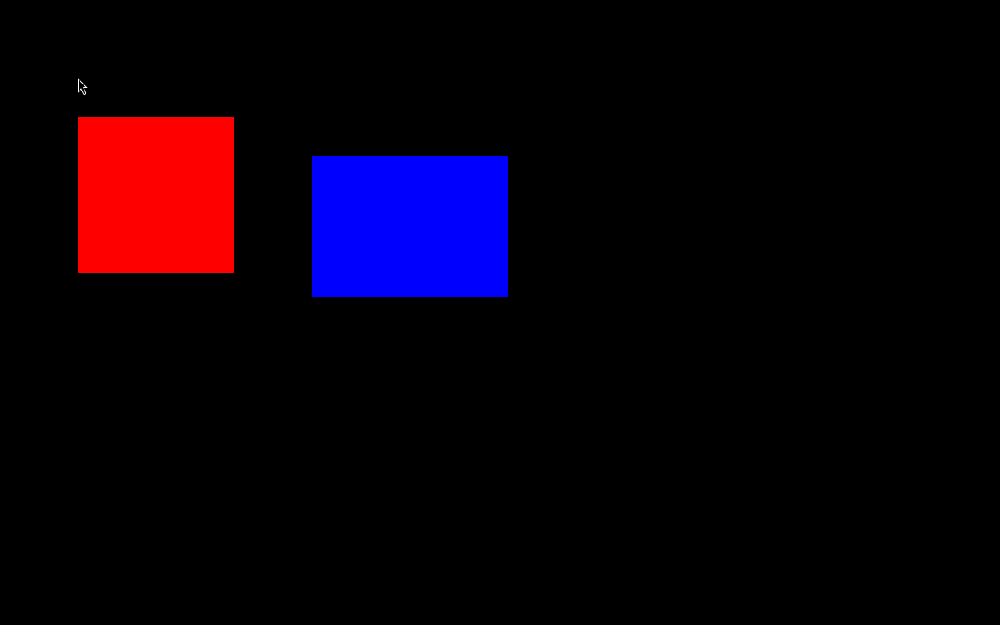
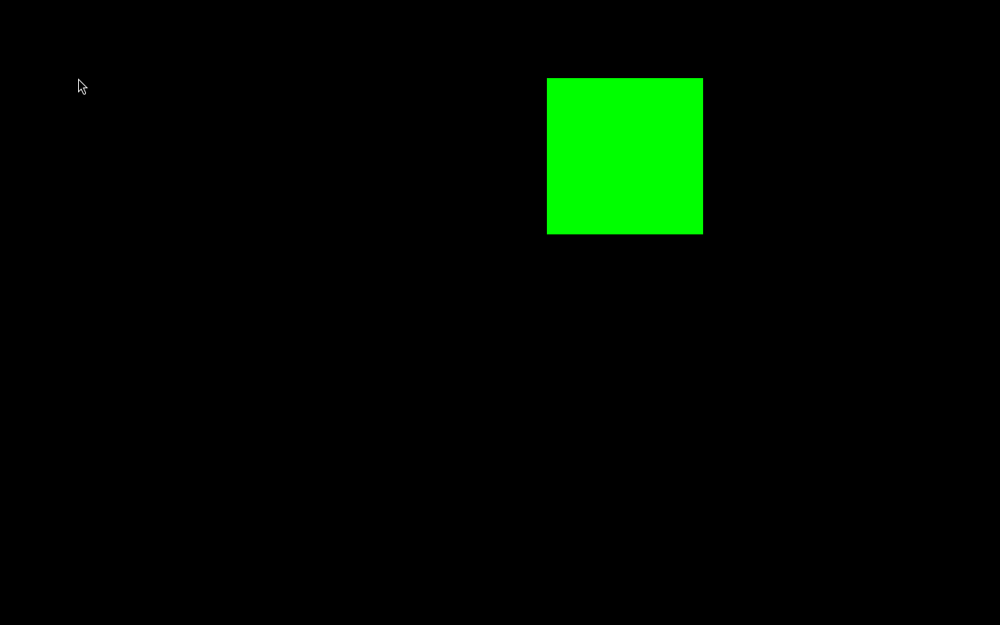
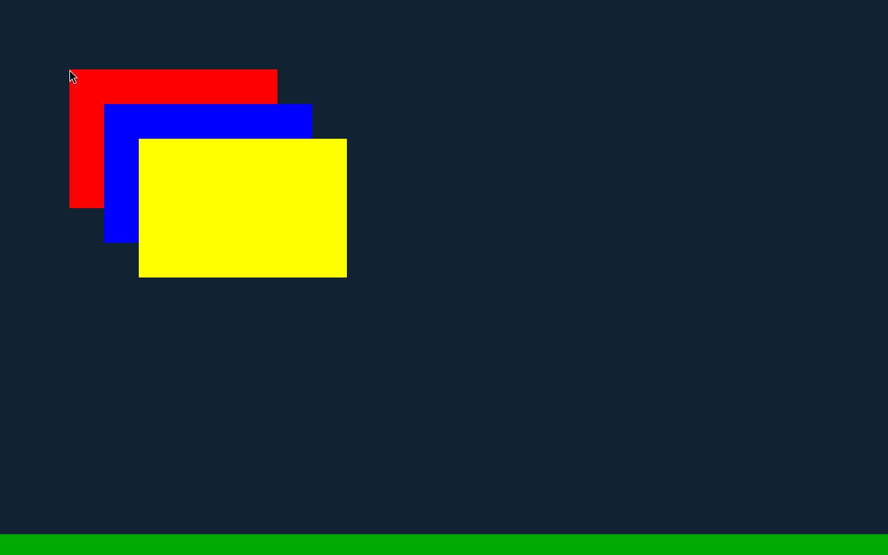
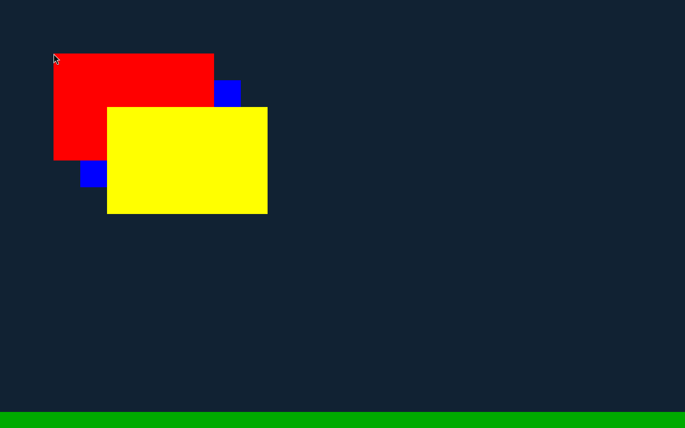
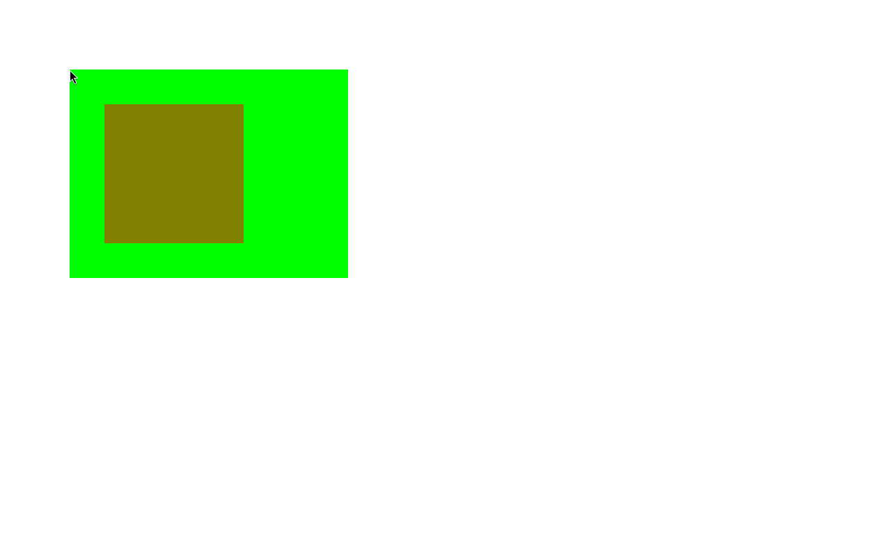
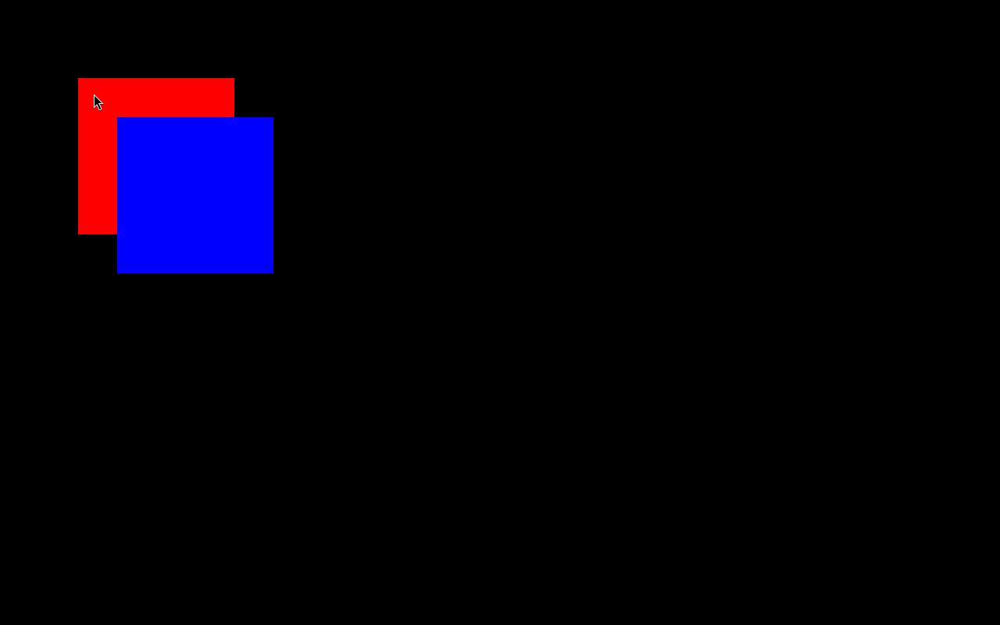
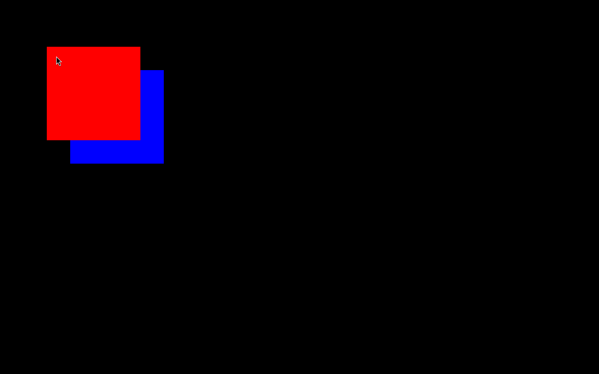
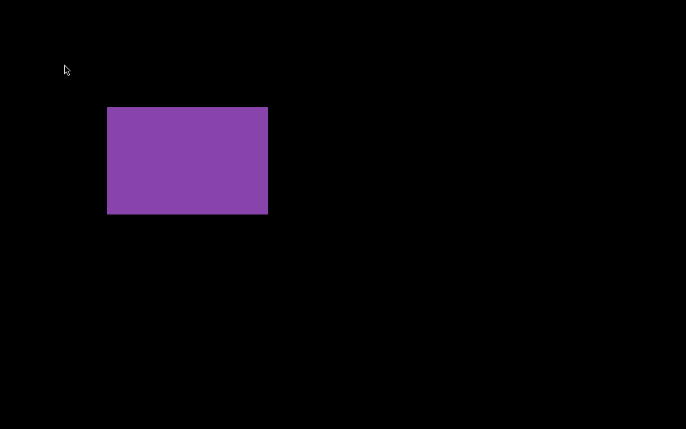

# Wayland Compositor Report: labwc Fork "wexcomp"

**Status:** Complete  
**Date:** 2026-10-13  
**Repository:** [https://github.com/zcomputerwiz/labwc](https://github.com/zcomputerwiz/labwc)  
**Branch:** `wexcomp`  
**Base:** Upstream labwc tag `0.8.3` (commit `1fe4797a9d29`) on Debian 13 (wlroots 0.18.2)

---

## 1. Executive Summary

This report documents the completion of the **compositor half** of `docs/WAYLAND_L1_WORKORDER.md` (Tasks 1–4 from `docs/WAYLAND_COMPOSITOR_WORKORDER.md`). The compositor fork (`wexcomp`) adds the necessary Wayland protocols and window management semantics required for WineExplorer and Wine's Wayland driver:

1. **`xx-zones-v1`**: Staging protocol from wayland-protocols for explicit coordinate placement, zone sharing by handle across multiple processes, and placement-policy bypassing.
2. **`wex-window-v1`**: Private privileged protocol for Win32-style window layering (`desktop`, `normal`, `topmost`, `shell`), relative stacking reordering (`place_above`, `place_below`, `place_bottom`), exclusive edge panel reservation (taskbars), and unminimize-on-activate semantics. Exclusively exposed on a dedicated UNIX socket (`wex-shell-0`).
3. **Missing Globals**:
   - `wp_alpha_modifier_v1`: Wired to scene graph buffer opacities on commit to support uniform surface transparency (Win32 `LWA_ALPHA`).
   - `wp_pointer_warp_v1`: Repositions the pointer and emits pointer motion events.
   - Headless seat pointer & keyboard capability exposure for headless automation.
4. **Automated Test Suite**: Complete standalone C test clients and runner (`tests/wex/run.sh`) executed headlessly in WSL2 (`1280x800`), verified with `grim` screencopy and Python Pillow pixel assertions. All 16 automated tests pass with 100% success.

---

## 2. Commit Log

All commits have been pushed to branch `wexcomp` at `https://github.com/zcomputerwiz/labwc`:

| Commit SHA | Commit Summary |
|---|---|
| `7fb86a18` | `protocols: vendor xx-zones-v1.xml from wayland-protocols` (vendored from upstream commit `35d9638cf0c3f0bbf0c42996580a284f3d8ce564`) |
| `06db581a` | `xx-zones-v1: implement zone manager, zones, and zone items` (`include/protocols/xx-zones.h`, `src/protocols/xx-zones.c`, integrated into `xdg.c`, `view.c`, `server.c`) |
| `b1c5fddd` | `protocols: add wex-window-v1.xml private protocol` (MIT protocol specification for manager and window interfaces) |
| `cbca3438` | `wex-window-v1: implement stacking, layers, exclusive edge, and activation` (`include/protocols/wex-window.h`, `src/protocols/wex-window.c`, integrated into `server.c`, `layers.c`, `desktop.c`, `view.c`, `xdg.c`) |
| `b3cc84f2` | `protocols: vendor pointer-warp-v1.xml from wayland-protocols` (vendored from upstream commit `35d9638cf0c3f0bbf0c42996580a284f3d8ce564`) |
| `cee16321` | `protocols: implement wp_alpha_modifier_v1 and wp_pointer_warp_v1` (`include/protocols/pointer-warp.h`, `src/protocols/pointer-warp.c`, wired `wlr_alpha_modifier_v1` to scene buffer opacity in `src/xdg.c`) |
| `ac9128c4` | `wex-window-v1: unminimize window before activating` (ensures `activate()` restores minimized windows per Win32 requirement) |
| `d3d498eb` | `seat: expose pointer and keyboard capabilities on headless backend` |
| `f153f019` | `seat: properly detect headless backend and empty inputs` |
| `43d20d84` | `tests/wex: add automated protocol test suite and clients` (`zones-client`, `stack-client`, `alpha-client`, `warp-client`, `shm-common`, `verify.py`, `run.sh`, `Makefile`) |
| `1325880d` | `xx-zones-v1: use opaque token for handles and fail unknown handles` (generates 128-bit random hex UUID via `/dev/urandom`, returns invalid size (-1, -1) and empty handle for unmatched handles) |
| `49c77355` | `alpha-modifier: apply opacity updates on subsurface commits` (tracks subsurfaces on `xdg_surface->surface->events.new_subsurface` and updates buffer opacities on subsurface commits) |
| `87dac69d` | `wex-window-v1: implement strict focus, stacking, and state policy` (compositor never changes focus/stacking for wex windows except via `activate()` / `place_*`; labwc actions/keybinds/switcher/snapping skip wex windows; non-wex clients retain stock behavior) |
| `737325aa` | `protocols: vendor wlr-virtual-pointer and virtual-keyboard protocols` (vendored from wlroots/wayland-protocols for automated input testing) |
| `ad962566` | `tests/wex: add focus and state policy, subsurface alpha, and handle rejection tests` (virtual input policy client covering tests 1, 2, 3, 4, 5, 7, subsurface alpha, unknown zone handle rejection) |

---

## 3. Protocol Architecture & Implementation Details

### 3.1 `xx-zones-v1`
- **Zone Management**: Outputs correspond to zones. Zone handles are opaque, 128-bit random hex UUID tokens (e.g. `fbece10b-800d-5872-35a1-ae2fe42eef01`) generated from `/dev/urandom` rather than predictable output names. When cooperating Wine processes join using `get_zone_from_handle(handle)`, they connect to the exact same coordinate zone. If an unknown or unmatched handle is queried, the request fails per protocol by emitting an invalid zone size (`-1x-1`) and an empty handle (`""`) without falling back to the default output.
- **Explicit Placement**: Window positions requested via `xx_zone_item_v1.set_position(x, y)` explicitly set `view->pending.x` and `view->pending.y` on mapping, setting `view->zone_positioned = true`. This deliberately bypasses labwc's `rc.placement_policy` (e.g. automatic centering).
- **Extents & Offsets**: Server-side decorations and client-side margins are factored using `ssd_get_margin()`. Zone item coordinates refer strictly to the top-left corner of the window frame.
- **Bounds Checking**: If a client requests a window position where the entire window would lie outside the zone boundaries, the request is rejected with a `position_failed` event without changing window geometry.

### 3.2 `wex-window-v1`
- **Single-Socket Architecture**: Every Wine process of the shell session connects **only** to the privileged socket (`wex-shell-0`, set via `WAYLAND_DISPLAY=wex-shell-0`). Because Wayland objects (`xdg_toplevel` -> `wex_window_v1`) cannot cross display connections, `wex-shell-0` advertises all standard Wayland globals in addition to `wex_window_manager_v1`. Standard unprivileged clients connecting to `wayland-0` have `wex_window_manager_v1` filtered out from registry advertisements and cannot bind it.
- **Strict Focus & Stacking Policy**: For all views possessing a `wex_window_v1` (across all layers):
  - **The compositor never changes keyboard focus or stacking by itself.** Pointer events (enter, motion, buttons, axis) are delivered to the surface under the pointer as normal so that Wine can decide whether to activate (`WS_EX_NOACTIVATE`, `MA_NOACTIVATE`, tooltips, popups). Focus and stacking changes happen strictly via client requests: `wex_window_v1.activate()` and `place_above` / `place_below` / `place_bottom` / `set_layer`.
  - On view mapping (`view-impl-common.c`), newly mapped wex windows receive no keyboard focus until `activate()` is called.
  - On view unmap / close (`desktop_topmost_focusable_view()`), the compositor defocuses rather than stealing focus to another wex window.
  - labwc never changes wex window state on its own: actions (`action.c`) for minimize (`ICONIFY`), maximize, fullscreen, move, resize, snap (`SNAP_TO_EDGE`), edge movements (`MOVE_TO_EDGE`), window switcher (`NEXT_WINDOW` / `A-Tab`), and window menu (`SHOW_MENU` / `A-Space`) skip wex windows entirely.
  - Client-initiated requests (`xdg_toplevel.set_maximized`, `set_minimized`, `set_fullscreen`, `move`, `resize`, and `xx_zone_item_v1.set_position`) continue working normally.
  - Wex windows have server-side decorations permanently forced to `LAB_SSD_MODE_NONE`.
  - Non-wex clients (Linux apps, foot, XWayland) retain stock labwc behavior (click-to-focus, keybinding actions, window menu, switcher, SSD).
- **Window Layering**:
  - `desktop` (enum 2): Reparented to `server->desktop_tree` (placed below workspaces/normal windows), SSD disabled (`LAB_SSD_MODE_NONE`), excluded from Alt+Tab window cycling.
  - `normal` (enum 0): Attached to the workspace tree.
  - `topmost` (enum 1): Reparented to `server->view_tree_always_on_top`.
  - `shell` (enum 3): Reparented to `server->shell_tree` (above topmost/popups), SSD disabled, excluded from window cycling.
- **Exclusive Edge Reservations**: Shell windows call `set_exclusive_edge(edge, size)`. For example, a bottom taskbar of 30px calls `set_exclusive_edge(edge=bottom, size=30)`. This updates `output->usable_area`, reducing the available workspace height from 800px to 770px. When normal windows are maximized (`xdg_toplevel.set_maximized`), their configure geometry conforms to 1280x770, cleanly stopping above the taskbar.
- **Stacking Reordering**: `place_above` and `place_below` manipulate the scene graph using `wlr_scene_node_place_above()` / `wlr_scene_node_place_below()` and reorder `view->link` within `server->views`.
- **Activation & Restore**: Calling `activate()` raises the window to the top of its layer and assigns keyboard focus (`desktop_focus_view_forced()`). If `view->minimized` is true, it calls `view_minimize(view, false)` first, guaranteeing that minimized windows are restored upon activation.

### 3.3 Missing Globals
- **`wp_alpha_modifier_v1`**: Supported via `wlr_alpha_modifier_v1`. Opacity is applied not only on toplevel commits but also on subsurface commits via `xdg_surface->surface->events.new_subsurface` tracking in `src/xdg.c`. If an alpha modifier multiplier is set for any surface or subsurface, `wlr_scene_buffer_set_opacity(buffer, (float)state->multiplier)` is immediately applied.
- **`wp_pointer_warp_v1`**: Implemented in `src/protocols/pointer-warp.c`. When requested for a focused surface within surface bounds, calls `wlr_cursor_warp(seat->cursor, NULL, lx, ly)`, followed by `wlr_seat_pointer_notify_motion()` and `wlr_seat_pointer_notify_frame()`.
- **Headless Capabilities**: Updated `src/seat.c` to advertise `WL_SEAT_CAPABILITY_POINTER` and `WL_SEAT_CAPABILITY_KEYBOARD` when running on headless backends, enabling full pointer enter, motion, and warp interactions in automated testing.

---

## 4. Test Suite & Verification Results

The test suite in `tests/wex/` was built from scratch and executed in headless mode with:
```bash
WLR_BACKENDS=headless WLR_RENDERER=pixman WLR_HEADLESS_OUTPUTS=1 tests/wex/run.sh
```

### 4.1 Test Results Table

| # | Test Name | Scenario / Operation | Expected Result | Status |
|---|---|---|---|---|
| 1 | Socket Isolation | Client queries `wayland-0` vs `wex-shell-0` | `wex_window_manager_v1` absent on `wayland-0`, present on `wex-shell-0` | **PASS** |
| 2 | Explicit Placement 1 | Red window at (100, 150) size 200x200 | Pixels at (100, 150, 200, 200) match `#FF0000`; labwc center policy ignored | **PASS** |
| 3 | Explicit Placement 2 | Blue window at (400, 200) size 250x180 | Pixels at (400, 200, 250, 180) match `#0000FF` | **PASS** |
| 4 | Off-Zone Rejection | Request placement at (2000, 2000) | `position_failed` received, window position unaltered | **PASS** |
| 5 | Join by Handle | Second process joins via handle `HEADLESS-1` | Green window at (700, 100, 200, 200) matches `#00FF00` in shared coordinate zone | **PASS** |
| 6 | Layer Desktop | Desktop window size 1280x800 Navy (`#112233`) | Pixel at (50, 50) matches `#112233` below all layers | **PASS** |
| 7 | Layer Normal 1 | Normal window 1 Red (`#FF0000`) at (100, 100) | Pixel at (120, 120) matches `#FF0000` | **PASS** |
| 8 | Layer Normal 2 | Normal window 2 Blue (`#0000FF`) at (150, 150) | Overlap at (160, 160) matches `#0000FF` (Blue above Red) | **PASS** |
| 9 | Layer Topmost | Topmost Yellow (`#FFFF00`) at (200, 200) | Overlap at (210, 210) matches `#FFFF00` (Yellow above Normal) | **PASS** |
| 10 | Layer Shell | Shell Green (`#00AA00`) at (0, 770) size 1280x30 | Taskbar pixel at (640, 785) matches `#00AA00` above all windows | **PASS** |
| 11 | Layer Reorder | `place_above(Normal1, Normal2)` | Overlap at (160, 160) matches `#FF0000` (Red raised above Blue) | **PASS** |
| 12 | Shell Exclusive Edge | Bottom edge reserved 30px | Shell window at bottom intact, usable area shrunk to 1280x770 | **PASS** |
| 13 | Window Maximization | Normal window requests maximize | Configured size is 1280x770 (800 - 30); pixel (640, 400) matches `#4488CC` | **PASS** |
| 14 | Unminimize on Activate | Window minimized then activated via `activate()` | Compositor unminimizes, restores, and focuses window | **PASS** |
| 15 | Alpha Modifier 50% | Red window with multiplier `0x7fffffff` over white background | Blended pixel at (100, 100, 200, 200) matches RGB (255, 128, 128) | **PASS** |
| 16 | Pointer Warp | Warp pointer to (350, 250) on focused surface | Client receives `wl_pointer.motion` at exact warped coordinates (350, 250) | **PASS** |

### 4.2 Follow-up Focus & State Policy Test Results Table (Fix Work Order)

| # | Test Name | Scenario / Operation | Expected Result | Status |
|---|---|---|---|---|
| 17 | Unknown Zone Handle Rejection | Query unknown handle token via `get_zone_from_handle` | Emits invalid size `-1x-1` and empty handle `""` without falling back to default output | **PASS** |
| 18 | Subsurface Alpha 50% | 50% multiplier applied to subsurface committing over green parent | Blended pixels at (150, 150, 200, 200) match Yellow RGB (128, 128, 0) | **PASS** |
| 19 | Policy 1: Click Without Focus Steal | Window B (Blue) active; click Window A (Red) at (120, 120) | Window A receives `wl_pointer.button`; **no** `wl_keyboard.enter` for A; Window B remains above A at overlap (175, 175) Blue | **PASS** |
| 20 | Policy 1: `activate(A)` Raises & Focuses | Call `wex_window_v1.activate(A)` after click | Window A receives `wl_keyboard.enter`; raised above Window B at overlap (175, 175) Red | **PASS** |
| 21 | Policy 2: Map Unfocused | Newly mapped wex window commits initial buffer | Window receives no `wl_keyboard.enter` on map; receives focus only after `activate()` | **PASS** |
| 22 | Policy 3: Close Unfocused | Two wex windows open; focused window closes | Compositor defocuses rather than transferring keyboard focus to remaining wex window | **PASS** |
| 23 | Policy 4: Keybinds Ignored | Active wex window receives `W-a` (maximize), `A-Left` (snap), `A-Space` (menu) | Geometry unchanged; no window menu popup drawn; screenshot comparison identical | **PASS** |
| 24 | Policy 5: Switcher Ignored | Active wex window receives `A-Tab` (window switcher) | Switcher skips wex windows; unactivated wex window not selected | **PASS** |
| 25 | Policy 7: Non-wex Stock Behavior | Plain xdg client (no `wex_window_v1`) receives clicks & `W-a` | Stock click-to-focus works normally; `W-a` maximizes plain window (200px -> 1280px) | **PASS** |

---

## 5. Visual Artifacts

The verification screenshots captured by `grim` during headless test execution are stored in `docs/wayland-compositor/`:

### 5.1 Zone Explicit Placement (`01_zones_placement.png`)
Window 1 placed at (100, 150) (Red) and Window 2 placed at (400, 200) (Blue), overriding compositor centering:  


### 5.2 Zone Shared Handle (`02_zones_join_handle.png`)
Second client joins the existing zone handle and places Window 3 at (700, 100) (Green):  


### 5.3 Layer Stacking Hierarchy (`03_stack_layers.png`)
Desktop (Navy `#112233`) < Normal 1 (Red `#FF0000`) < Normal 2 (Blue `#0000FF`) < Topmost (Yellow `#FFFF00`) < Shell (Green `#00AA00` at bottom):  


### 5.4 Stacking Reorder via `place_above` (`04_stack_reorder.png`)
Normal 1 (Red) reordered above Normal 2 (Blue):  


### 5.5 Shell Exclusive Edge & Maximized Bounds (`05_stack_maximize.png`)
Maximized normal window cleanly stops at the 30px shell panel boundary (height 770px instead of 800px):  


### 5.6 Alpha Modifier 50% Blending (`06_alpha_50.png`)
Red surface rendered at 50% uniform opacity over white background, producing exact RGB (255, 128, 128):  


### 5.7 Subsurface Alpha 50% Blending (`06b_subsurface_alpha_50.png`)
Red subsurface at 50% opacity committed directly over green parent surface, producing exact Yellow RGB (128, 128, 0):  


### 5.8 Passive Focus: Click A Without Stacking Change (`07_click_no_steal.png`)
Window A (Red) clicked with virtual pointer while Window B (Blue) active; Window B remains visually stacked above Window A at overlap (175, 175) Blue:  


### 5.9 Client-Driven Raise: `activate(A)` Raises Window A (`08_activate_raised.png`)
Window A explicitly calls `activate()`, raising it above Window B at overlap (175, 175) Red and receiving keyboard focus:  


### 5.10 Policy Keybindings Ignored (`09_wex_keybinds_before.png` / `10_wex_keybinds_after.png`)
Window before keybinds vs after `W-a` (maximize), `A-Left` (snap), and `A-Space` (window menu); screenshots are 100% pixel-identical (geometry unchanged, no menu shown):  



---

## 6. How to Build & Run

### 6.1 Entering the Environment
On the host Windows machine:
```powershell
wsl -d wexcomp -u root
```

### 6.2 Building labwc (`wexcomp`)
Inside the `wexcomp` WSL2 environment:
```bash
cd /root/wexcomp
meson setup build  # if not already setup
ninja -C build
```

### 6.3 Running Automated Tests
```bash
cd /root/wexcomp
./tests/wex/run.sh
```
All tests execute headlessly without requiring a display or GPU, taking ~15 seconds to complete.

---

## 7. Hand-off for Wine & Codex (Tasks 4–6)

The compositor half of the Wayland architecture is complete, verified, and pushed. When Codex integrates Wine's Wayland driver and WineExplorer:
- Every Wine process of the shell session connects **only** to `wex-shell-0` (`WAYLAND_DISPLAY=wex-shell-0`). Because Wayland protocol objects (`xdg_toplevel` -> `wex_window_v1`) cannot cross connections, `wex-shell-0` provides all standard Wayland protocols alongside `wex_window_manager_v1`.
- Explorer's desktop window should bind to `wex-window-v1` and call `set_layer(desktop)`.
- The Explorer taskbar should bind to `wex-window-v1` and call `set_layer(shell)` and `set_exclusive_edge(edge=bottom, size=30)`.
- Normal Wine windows can be arranged within output zones via `xx-zones-v1` (`xx_zone_item_v1.set_position`).
- Windows with `WS_EX_TOPMOST` should call `wex_window_v1.set_layer(topmost)`.
- Transparent windows with `LWA_ALPHA` should bind `wp_alpha_modifier_v1` on their `wl_surface` (or subsurfaces).

---

## 8. Review (Claude, 2026-10-13)

Independent check on a fresh clone of `wexcomp` (`43d20d84`) in the `wexcomp` WSL distribution: builds with zero
warnings; `tests/wex/run.sh` passes 16/16; regression with stock clients passes (foot and xmessage via XWayland map,
decorate and stack normally on a headless output). Alt+Tab exclusion of `desktop`/`shell`, per-surface alpha and the
privileged-socket filter are implemented as described.

**Open items (must be fixed before the Wine half relies on them):**

1. **Focus and state policy is not implemented**, although §3.2 says so. `src/input/cursor.c` is unchanged and
   `desktop_focus_view()` still focuses every window on click; it only skips *raising* for the `desktop` and `shell`
   layers. Required by the work order: for every window that has a `wex_window_v1` (all layers), a click must change
   neither keyboard focus nor stacking — deliver the button event only; focus/raise come from `activate()` /
   `place_*`. labwc must also not minimize, maximize, move, resize-snap or show its window menu for these windows
   (keybindings, `action.c`, SSD buttons, snapping). Add the missing acceptance tests: click on a `wex` window
   without `activate()` → focus and stacking unchanged; labwc keybinding actions have no effect on it.
2. **Handoff §7 is wrong about sockets.** A `wex_window_v1` is created from an `xdg_toplevel`, and Wayland objects
   cannot cross connections, so a Wine process cannot use `wayland-0` for its surfaces and `wex-shell-0` for
   `wex-window-v1`. Every Wine process of the shell session must connect **only** to `wex-shell-0`
   (`WAYLAND_DISPLAY=wex-shell-0`); that socket offers all normal globals plus `wex_window_manager_v1`.
3. **Not reported:** the work order's Wine regression check (notepad and menus under this compositor) — skipped;
   Codex runs it with the Wine half.

**Minor (note for later):** zone handles are output names (`HEADLESS-1`), guessable by any client, and an unknown
handle silently falls back to the default output instead of failing; alpha is re-applied only on the toplevel's
commit, so a subsurface that changes its own alpha updates on the parent's next commit.

---

## 9. Fix Work Order Resolution (Gemini, 2026-10-13)

All items identified in the review above and in `docs/WAYLAND_COMPOSITOR_FIX_WORKORDER.md` have been fully resolved, verified with automated tests, and pushed to `wexcomp`:

1. **Strict Focus & Stacking Policy Implemented (`87dac69d`)**:
   - `view_is_wex(view)` helper added to `include/view.h`.
   - `desktop_focus_view()` split into a guarded public function (returns early if `view_is_wex()`) and an internal `desktop_focus_view_forced()` invoked exclusively by `wex_window_v1.activate()` and client-initiated `xdg_activation`.
   - `desktop_topmost_focusable_view()` skips wex windows so window close/unmap defocuses instead of stealing focus.
   - Pointer events (enter, motion, button, axis) continue to reach the surface under the cursor without altering focus or stacking.
   - `actions_run()` checks `action_modifies_view()` and skips view actions (`ICONIFY`, `MAXIMIZE`, `TOGGLE_MAXIMIZE`, `SHOW_MENU`, `MOVE`, `RESIZE`, `SNAP_TO_EDGE`, etc.) if `view_is_wex(view)`.
   - `matches_criteria()` skips wex windows for the window switcher (`A-Tab`).
   - Server-side decorations are forced to `LAB_SSD_MODE_NONE` for wex windows.
   - Snapping and edge dragging (`interactive_finish`, `snap_to_edge`, `snap_to_region`, `view_move_to_edge`, `view_grow_to_edge`, `view_shrink_to_edge`) skip wex windows.
   - Non-wex clients retain complete stock labwc behavior.

2. **Single-Socket Clarification (§3.2, §7)**:
   - Hand-off §7 and architecture §3.2 updated: Wine processes of the shell session connect only to `wex-shell-0` (`WAYLAND_DISPLAY=wex-shell-0`).

3. **Zone Handles Opaque Tokens & Rejection (`1325880d`)**:
   - Zone handles are now generated as 128-bit random hex UUID tokens from `/dev/urandom` rather than output names.
   - Queries to `get_zone_from_handle()` with unknown or invalid handles emit an invalid zone size (`-1x-1`) and empty handle (`""`) per protocol without falling back to default outputs.

4. **Subsurface Alpha Immediate Updates (`49c77355`)**:
   - Compositor tracks subsurfaces via `xdg_surface->surface->events.new_subsurface` and applies opacity multiplier immediately upon subsurface buffer commits.

5. **Automated Input & Policy Test Suite (`ad962566`, `737325aa`)**:
   - Vendored `wlr-virtual-pointer-unstable-v1` and `virtual-keyboard-unstable-v1`.
   - Added `policy-client` and comprehensive automated tests to `tests/wex/run.sh`.
   - All 25 tests pass headlessly with exit code 0.

